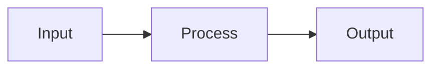
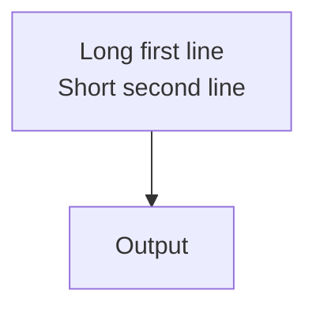

# Figures, video, and Mermaid

Keep media ownership and per-file cross-deck symlinks consistent with repository AGENTS.md. Verify local paths, captions, and source attribution. For PDF output, check a useful static representation of video when the user needs printable content.

## Figures and Media

```markdown
<figure>

<figcaption>Caption text</figcaption>
</figure>
```

With width control:

```markdown
<figure style="width: 75%;">

<figcaption>Caption</figcaption>
</figure>
```

Video:

```markdown
<figure>
<video src="assets/video/demo.mp4" autoplay loop muted></video>
<figcaption>Demo video</figcaption>
</figure>
```

### Fit media and its caption to the remaining body

On a regular slide, select the caption-aware defaults with one direct `.body`
wrapper. `.body.box` is a single area; `.body.col.visual` supports a figure
beside its interpretation. A multiline heading above the body or a multiline
caption reduces the media area while keeping the text's natural height.

```markdown
## Result under the tested condition

<div class="body box">
<figure>

<figcaption>Source and conditions needed to interpret the figure</figcaption>
</figure>
</div>
```

Direct image, video, and SVG children of a figure share the remaining media
height with `contain` defaults. Multiple figures in a `.box` or column share
the column's remaining height and keep their own captions. Keep a continuous
height chain: use `.box.fill` or `.col.fill` for a nested growing area instead
of an anonymous wrapper or `height: 100%` beside a caption.

Choose the column ratio with `--visual-left/right` first, then adjust
`--body-gap` or `--figure-gap` on the relevant wrapper. `--visual-gap` sets
the visual column gap. A whole fixed-height figure may use
`style="flex: none; height: 280px"`; its caption is included in that height.
Use `style="flex: 2"` to allocate more height to one stacked figure. Allow
extra `--body-bottom-safe` for a tall footnote/footer.

To keep an intentionally fixed inline image/video size inside the new body,
use `<figure class="figure-natural">`. Existing `.fill`-only slides keep their
current behavior without migration. Explicit inline crop (`object-fit: cover`,
`object-position`) still works in a fitting figure; preserve authored SVG
viewport settings. Do not add crop to solve overflow. If text itself cannot
fit, revise or split after rendering. The body leaves excess content visible
to diagnostics instead of shrinking text or enabling scroll.

Title, paper, and `_scroll` slides use their existing layout contracts. Full
defaults and migration examples are in `docs/theme-contract.md`.

## Mermaid Diagrams

Plain `mermaid` fences use MarpAgent's cached renderer and support `$...$` math in diagram labels. Attribute-bearing fences such as `mermaid interactive` use Core 5's renderer; diagram math and the MarpAgent cache apply only to plain fences. Choose the plain fence for printable research diagrams with formulas. Check the intended HTML and static output when using interactive diagrams.

Both renderers use the active theme's Shiki palette and the same `--mermaid-*` sizing controls below. For a needed local color change, set `--marp-mermaid-foreground`, `--marp-mermaid-line`, or `--marp-mermaid-accent` on the wrapper instead of rewriting generated SVG elements. Cached diagrams follow these CSS overrides without rerendering.

Wrap in a width-constrained div:

````markdown
<div style="width: 90%">



</div>
````

Use `<br/>` or `\n` inside a quoted label when a node label needs a line break:

````markdown

````

Sizing note: Mermaid is laid out before slide CSS is applied. Scoped CSS such
as `.my-flow svg text { font-size: 20px }` changes visible text only and does
not resize node boxes. To make a diagram larger, scale the SVG/container:

````markdown
<div style="width: 90%; --mermaid-width: 115%; --mermaid-max-width: none; --mermaid-overflow: visible">


</div>
````
