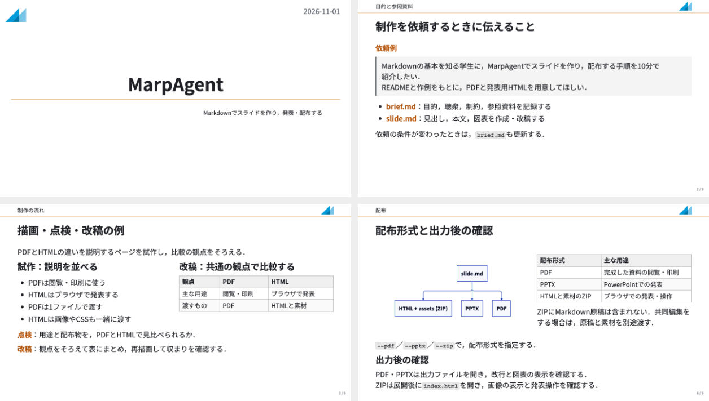

# MarpAgent

Create and revise Marp presentations in Markdown, with shared themes, AI authoring
skills, live previews, and rendered checks. Present in the browser or distribute
PDF, PPTX, and portable HTML ZIPs from the same source.

[](decks/example/slide.pdf)

Start with the **[10-slide introduction (PDF)](decks/example/slide.pdf)**,
its [Markdown source](decks/example/slide.md), and its [brief](decks/example/brief.md).
The Japanese example follows a concrete request through drafting, inspection,
revision, presentation, and distribution. It uses the default `lab` theme.

## Overview

| Work | What MarpAgent provides |
| :--- | :--- |
| Draft and revise | A Markdown source, shared themes and layout recipes, and agent skills for creating or editing decks |
| Inspect | Live preview, a thumbnail overview, and checks for clipping, collisions, unreadably small text, and rendering failures |
| Present | HTML presentation controls, a laser pointer, and opt-in synchronized body scrolling |
| Distribute | PDF, PPTX, or a ZIP containing HTML and its referenced local resources |

Rendered checks help find display defects. Review the argument, supporting
evidence, figure labels, and reading order in the rendered slides too.

## Prerequisites

Use Node.js 25.x. The repository pins Node 25.6.0 and D2 0.9.0 in `.mise.toml`.
With [mise](https://mise.jdx.dev/) installed, run from the repository root:

```bash
mise install
mise exec -- npm ci
mise exec -- npx playwright install --with-deps chromium
```

Chromium is required for rendered validation and image/PDF/PPTX exports. D2 is
used by the introduction example's distribution diagram. If another tool
manages Node.js, run `npm ci` and the browser installation command directly;
install D2 0.9.0 separately and put it on `PATH` or set `MARP_AGENT_D2_PATH`.
See [D2 setup](docs/d2.md) for explicit tool and font configuration.

The commands below use `npm run marpx --` and work without mise shell activation.
With mise active, the repository also provides the shorter `marpx` command.
See [rendering environment details](docs/usage.md#rendering-environment) for engine,
font, and diagram conditions, and [CI setup](docs/ci.md) for contributor tools.

## Quick Start

Try the example before creating a deck:

```bash
npm run marpx -- decks/example/slide.md
```

Then create a new destination and edit its `brief.md` and `slide.md`:

```bash
# Create a deck.
npm run marpx -- -n decks/my-talk

# After adding your text and figures, preview the draft.
npm run marpx -- decks/my-talk/slide.md

# Inspect the sequence in the thumbnail overview.
npm run marpx -- decks/my-talk/slide.md --overview

# Validate the rendered deck, then export a PDF.
npm run marpx -- decks/my-talk/slide.md -v --strict
npm run marpx -- decks/my-talk/slide.md --pdf
```

Preview and overview keep running until stopped with Ctrl+C. Start each command
after stopping the previous preview, or use another terminal. The PDF is written
next to `slide.md` unless `--output` selects another path.

Put purpose, audience, constraints, and sources in the short `brief.md`.
Develop the sequence, text, and figures directly in `slide.md`. Try an important
or uncertain page with an actual figure or table early, inspect it, and revise
that same source before extending the deck. Update the brief when requirements
change; ordinary page edits stay in the source.

## AI Agent Usage

The repository's `.agents/skills/` contains guidance for agents that can read
local files. Use `slide-author` for both new and existing decks:

```text
/slide-author my-talk
Use the supplied README and figures to introduce the project to students
in 10 minutes. Prepare a PDF and HTML presentation. Try the key comparison
page first, inspect its render, and revise before completing the deck.
```

For an existing deck, name the source and requested change:

```text
/slide-author decks/my-talk/slide.md
Add a comparison of PDF and HTML distribution after the introduction.
Preserve the sources and conditions, then check the affected renders.
```

| Task skill | Use it for |
| :--- | :--- |
| `slide-author` | Create, revise, restructure, or add pages; rendering and correction are part of authoring |
| `slide-review` | Report content and rendering findings; edit only when fixes are requested |
| `paper-new` | Create a single-page A-series paper layout |
| `theme-new` | Create or adapt a theme from a URL, brand guide, or `DESIGN.md` |

Invocation syntax depends on the agent. Clients without slash commands can read
the corresponding `.agents/skills/<name>/SKILL.md` directly. Layout, component,
paper, and validator references support these tasks; see [AGENTS.md](AGENTS.md).

The former authoring names are retired, with no compatibility aliases:

| Former invocation | Replacement |
| :--- | :--- |
| `/slide-new my-talk` | `/slide-author my-talk` with the topic and sources |
| `/slide-edit decks/my-talk/slide.md` | `/slide-author decks/my-talk/slide.md` with the requested revision |
| `/slide-add decks/my-talk/slide.md` | `/slide-author decks/my-talk/slide.md` with the new content and insertion point |

Update saved prompts and client-local skill links to use `slide-author`.

## Authoring and Revising

Choose the structure from what the audience needs to understand: a shared-criteria
table for comparison, a figure with nearby interpretation for a result, or a
sequence for a process. Start from the [layout recipes](template/README.md).
Regular pages use a heading followed by one `.body` wrapper. Keep explanations
and tables near the heading; use deliberate middle placement to align related
material. Inspect spacing and readable figure size across the whole canvas.

The example's “描画・点検・改稿の例” page shows a revision: separate PDF and HTML
statements become a table with the same comparison criteria. It is an illustrative
editing example, not a measured improvement in audience understanding.

Use `-v --strict` for a final rendered check. It fails when the check cannot run,
instead of accepting a source-only fallback. Also inspect each page and the
sequence for missing explanations, redundant material, and readable labels.
Do not shrink body text just to fit. Preserve sources and qualifications when
shortening a claim. Remove temporary drafting comments or turn them into
intentional speaker notes before delivery.

New decks do not need `outline.md`. Read any unique requirements in a legacy
outline and preserve that file. Create or synchronize an outline only when
requested. The deprecated generator remains documented in the
[usage reference](docs/usage.md#legacy-outlines).

## Present and Distribute

| Output | Command option | What to check |
| :--- | :--- | :--- |
| PDF | `--pdf` | Page breaks, line wrapping, and figures in the exported file |
| PPTX | `--pptx` | Slide appearance in PowerPoint |
| HTML | `--html` | Presentation controls and media; keep the file with the deck's assets |
| Portable HTML ZIP | `--zip --output out/talk.zip` | Extract it, open `index.html`, and check media and navigation |

The ZIP includes referenced local resources and a manifest. It excludes Markdown
sources, briefs, and speaker notes. Share source and assets separately for
collaborative editing. Remote dependencies are listed rather than downloaded;
`--zip --strict-offline` rejects them. See [HTML distribution details](docs/usage.md#distribute-html).

Opt-in scrolling is useful for a long table or appendix during an HTML
presentation. PDF, PPTX, and images show only the initial viewport; split pages
when a static handout must contain all the material.
See [scrolling and presenter synchronization](docs/usage.md#scroll-a-selected-slide-during-presentation).

## Theme

Use `lab` for the default research presentation design, `muji` for a quiet minimal
design, or `toshiba` for a high-contrast technical design. All three share the
layout and component system; the introduction example uses `lab`.

- [Design index](designs/README.md) — identities and token sources
- [Layout recipes](template/README.md) — comparisons, evidence with context, and processes
- [Theme and component reference](docs/usage.md#theme) — palettes, diagrams, logos, and theme creation
- [Theme contract](docs/theme-contract.md) — supported classes, type, spacing, and font conditions

For a dense single-page research output, use an [A-series paper layout](docs/usage.md#a-series-paper-layouts)
and the [worked example](decks/example-paper/paper.md).

## Reference and Contributing

- [Commands and rendering behavior](docs/usage.md#commands)
- [File structure and media ownership](docs/usage.md#file-structure)
- [Media discovery and reuse](docs/media-assets.md)
- [D2 configuration and diagnostics](docs/d2.md)
- [Agent quick reference](AGENTS.md)
- [CI and full acceptance](docs/ci.md)

Automatic PR checks validate records and, for engine-related paths, a lightweight
smoke suite. They do not replace rendered deck inspection or full acceptance.
Contributors should follow the CI guide for Chromium/Firefox, D2/font preparation,
`npm run ci:full`, and the separate dependency audit.
