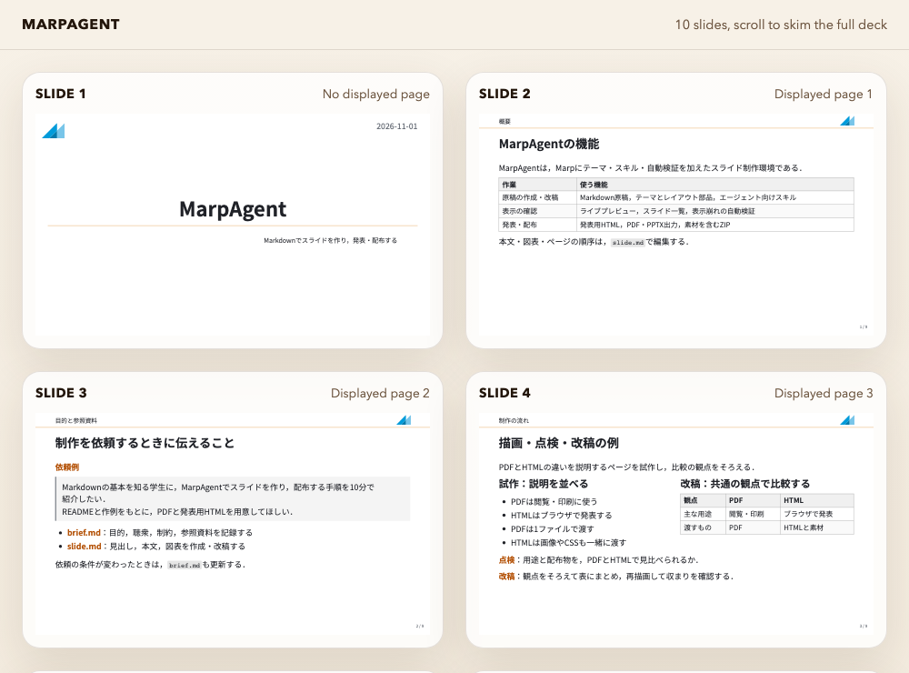
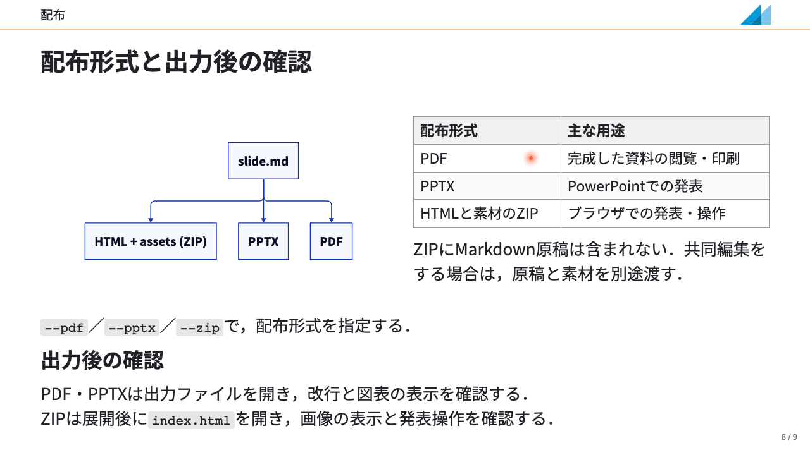

<!-- _paginate: skip -->
<!-- _class: title -->
<!-- _header: 2026-11-01 -->

# MarpAgent

<div class="author">

Markdownでスライドを作り，発表・配布する

</div>

---

<!-- _header: 概要 -->

## MarpAgentの機能

<div class="body box">

MarpAgentは，Marpにテーマ・スキル・自動検証を加えたスライド制作環境である．

| 作業 | 使う機能 |
| :--- | :--- |
| 原稿の作成・改稿 | Markdown原稿，テーマとレイアウト部品，エージェント向けスキル |
| 表示の確認 | ライブプレビュー，スライド一覧，表示崩れの自動検証 |
| 発表・配布 | 発表用HTML，PDF・PPTX出力，素材を含むZIP |

本文・図表・ページの順序は，`slide.md`で編集する．

</div>

---

<!-- _header: 目的と参照資料 -->

## 制作を依頼するときに伝えること

<div class="body box">

**依頼例**

> Markdownの基本を知る学生に，MarpAgentでスライドを作り，配布する手順を10分で紹介したい．
> READMEと作例をもとに，PDFと発表用HTMLを用意してほしい．

- **brief.md**：目的，聴衆，制約，参照資料を記録する
- **slide.md**：見出し，本文，図表を作成・改稿する

依頼の条件が変わったときは，`brief.md`も更新する．

</div>

---

<!-- _header: 制作の流れ -->

## 描画・点検・改稿の例

<div class="body box">

PDFとHTMLの違いを説明するページを試作し，比較の観点をそろえる．

<div class="col">
<div>

### 試作：説明を並べる

- PDFは閲覧・印刷に使う
- HTMLはブラウザで発表する
- PDFは1ファイルで渡す
- HTMLは画像やCSSも一緒に渡す

</div>
<div>

### 改稿：共通の観点で比較する

| 観点 | PDF | HTML |
| :--- | :--- | :--- |
| 主な用途 | 閲覧・印刷 | ブラウザで発表 |
| 渡すもの | PDF | HTMLと素材 |

</div>
</div>

**点検**：用途と配布物を，PDFとHTMLで見比べられるか．

**改稿**：観点をそろえて表にまとめ，再描画して収まりを確認する．

</div>

---

<!-- _header: 点検 -->

## 表示の自動検証と内容の点検

<div class="body box">

```bash
npm run marpx -- decks/example/slide.md -v --strict
```

| 自動検証で調べること | 人が判断すること |
| :--- | :--- |
| 画面端での欠け，文字の重なり | 聴衆に必要な説明・根拠があるか |
| 小さすぎる文字，画像の読み込み失敗 | 図のラベルや凡例を読めるか |
| 図・数式の描画エラー | 見出しと本文・図表が対応しているか |

`--strict`を付けると，描画検査を実行できない場合もエラーで終了する．

</div>

---

<!-- _header: デザイン -->

## テーマとレイアウト

<div class="body box">

| テーマ | 外観 |
| :--- | :--- |
| lab | 研究発表向けの標準デザイン |
| muji | 控えめで簡潔なデザイン |
| toshiba | コントラストの強い技術発表向けデザイン |

この作例では`lab`を使っている．比較表や段組みを使い，内容の関係に合わせて配置できる．

D2・Mermaidの図，数式，コードの構文強調にも対応している．

> [!TIP]
> 実際に使う図を描画し，ラベルとキャプションが読めるか確かめる．

</div>

---

<!-- _header: 全体構成 -->

## スライド一覧で話の流れを確認する

<div class="body col visual" style="--visual-left: 1.25; --visual-right: 0.75;">
<figure>

<figcaption>スライド一覧の表示例</figcaption>
</figure>
<div class="place-middle">

`--overview`で，全ページの並びを確認できる．

### 構成の点検

- 結論までの説明に不足はないか
- 説明が重複していないか

原稿に説明を補い，重複をまとめる．必要ならページの順序を変える．

</div>
</div>

---

<!-- _header: 発表 -->

## 発表用HTMLの操作

<div class="body col visual" style="--visual-left: 1; --visual-right: 1;">
<div class="place-middle">
<figure class="figure-natural">

<figcaption>レーザーポインタの表示例</figcaption>
</figure>
</div>
<div class="place-middle">

### ポインタと本文スクロール

- レーザーポインタで説明箇所を示す
- 長い表や付録は，本文をスクロールして読む

スクロール位置は，同じ発表セッションの発表者画面と同期する．

PDF・PPTX・画像の出力範囲は，スクロール前に見える部分に限られる．全文を載せるときは，ページを分ける．

</div>
</div>

---

<!-- _header: 配布 -->

## 配布形式と出力後の確認

<div class="body box">
<div class="col visual" style="--visual-left: 1; --visual-right: 1;">
<div>

```d2
direction: down
*.style.font-size: 30
source: slide.md
pdf: PDF
pptx: PPTX
bundle: HTML + assets (ZIP)
source -> pdf
source -> pptx
source -> bundle
```

</div>
<div>

| 配布形式 | 主な用途 |
| :--- | :--- |
| PDF | 完成した資料の閲覧・印刷 |
| PPTX | PowerPointでの発表 |
| HTMLと素材のZIP | ブラウザでの発表・操作 |

ZIPにMarkdown原稿は含まれない．共同編集をする場合は，原稿と素材を別途渡す．

</div>
</div>

`--pdf`／`--pptx`／`--zip`で，配布形式を指定する．

### 出力後の確認

PDF・PPTXは出力ファイルを開き，改行と図表の表示を確認する．
ZIPは展開後に`index.html`を開き，画像の表示と発表操作を確認する．

</div>

---

<!-- _header: 始め方 -->

## 手元の図や表で，最初の1枚を作る

<div class="body box">

環境構築の手順は[README](https://github.com/takumi-nishimura/MarpAgent#prerequisites)を参照する．以下はリポジトリ直下で実行する．

```bash
# Create a deck, then edit brief.md and slide.md.
npm run marpx -- -n decks/my-talk

# Preview the draft.
npm run marpx -- decks/my-talk/slide.md

# Validate and export.
npm run marpx -- decks/my-talk/slide.md -v --strict
npm run marpx -- decks/my-talk/slide.md --pdf
```

図表を実際に表示し，読める大きさか，説明と対応しているかを確かめる．

</div>
