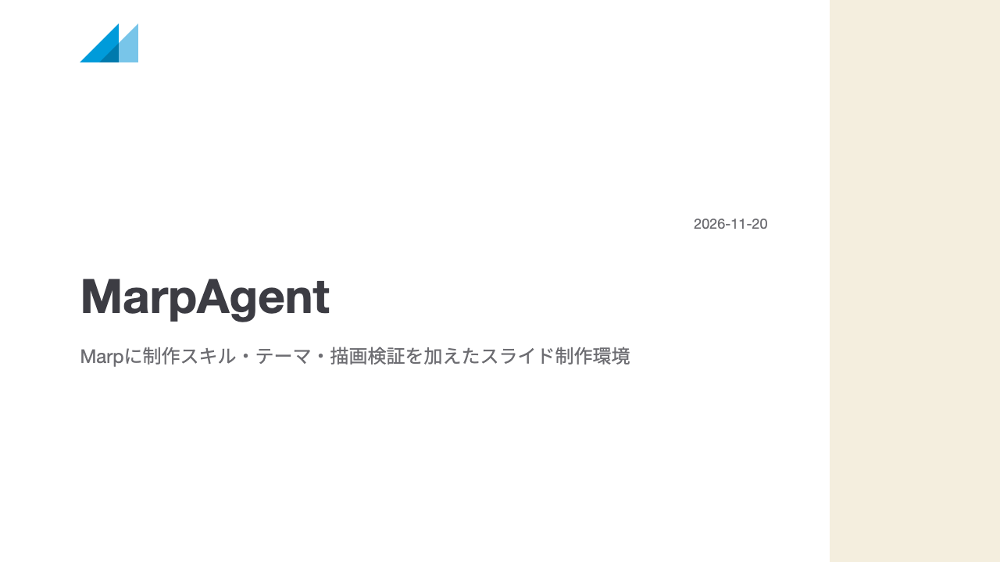
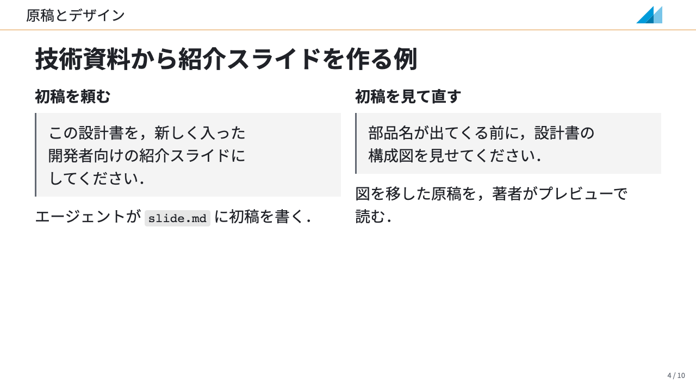
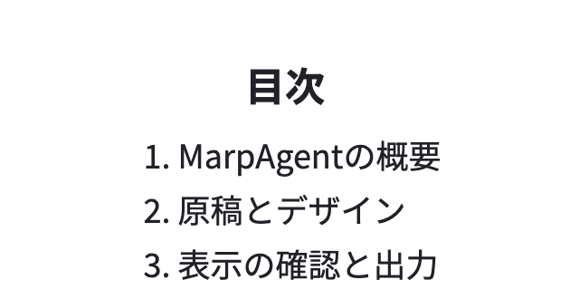
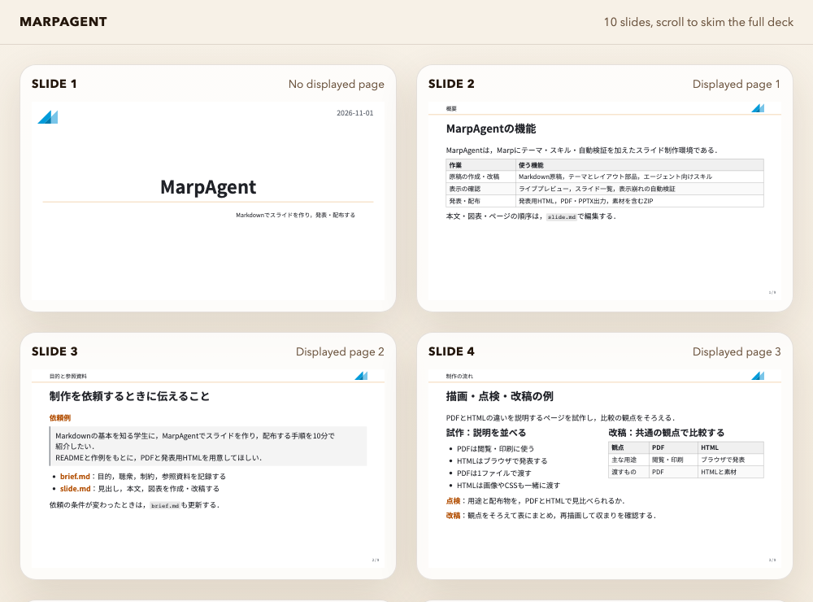
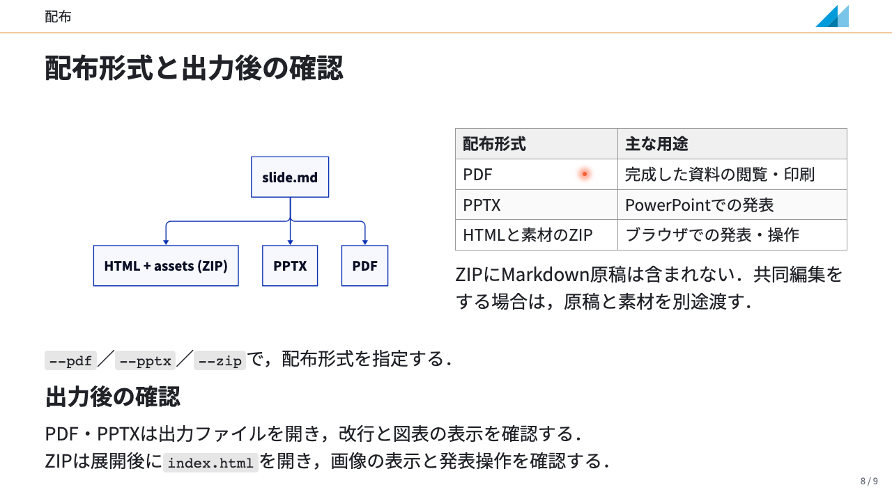

<!-- _paginate: skip -->
<!-- _class: title cover-muji -->
<!-- _header: 2026-11-20 -->

# MarpAgent

<div class="author">

Marpに制作スキル・テーマ・描画検証を加えたスライド制作環境

</div>

---

<!-- _class: toc-center -->
<!-- _toc: true -->

## 目次

---

<!-- header: MarpAgentの概要 -->

## MarpAgentとは

<div class="body box">

Marpでスライドを描画し，原稿の編集と表示の点検を支える制作環境．

```d2
direction: right
*.style.font-size: 27
edit: slide-author
source: slide.md
slide: Slides
check: Rendered checks
edit -> source
source -> slide: Marp + theme
slide -> check
```

</div>

---

<!-- header: 原稿とデザイン -->

## 手元の資料からスライドを作る

<div class="body box">

エージェントに元資料を渡し，誰に何を伝えたいかを添える．

| 渡す資料 | 作りたいスライドの例 |
| :--- | :--- |
| 技術資料 | 新しく参加した開発者に，システムの仕組みを紹介する |
| 論文原稿 | 学会発表で，研究の問いと主要な結果を伝える |
| 実験レポート | 研究室の進捗報告で，条件ごとの結果を見比べる |

</div>

---

<style scoped>
.body h3 { font-size: 1em; }
</style>

## 技術資料から紹介スライドを作る例

<div class="body col">
<div>

### 初稿を頼む

> この設計書を，新しく入った開発者向けの紹介スライドにしてください．

エージェントが `slide.md` に初稿を書く．

</div>
<div>

### 初稿を見て直す

> 部品名が出てくる前に，設計書の構成図を見せてください．

図を移した原稿を，著者がプレビューで読む．

</div>
</div>

---

## 表紙はMUJI，本文はLab

<div class="body col visual">
<figure>

<figcaption>表紙の指定　<code>title cover-muji</code></figcaption>
</figure>
<figure>

<figcaption>本文の指定　<code>theme: lab</code></figcaption>
</figure>
</div>

---

## 本文の章名から目次ができる

<div class="body col visual shares">
<figure style="--col-width: 47%">

<figcaption>自動生成した目次（2枚目）</figcaption>
</figure>
<div class="place-middle">

章の先頭で名前を指定する．

```markdown
<!-- header: 原稿とデザイン -->
```

`_toc: true` を置いたページに，各章の名前が順に並ぶ．

</div>
</div>

---

<!-- header: 表示の確認と出力 -->

## 一覧でページの順序を確かめる

<div class="body col visual shares">
<figure style="--col-width: 60%">

<figcaption>オーバービューの表示例</figcaption>
</figure>
<div class="place-middle">

`--overview` でデッキを見渡せる．

図のラベルや表の文字は，個々のページを開いて読む．

</div>
</div>

---

## 自動検証は描画したページを調べる

<div class="body box">

```sh
marpx decks/example/slide.md -v --strict
```

| 検査対象 | 検出する例 |
| :--- | :--- |
| 本文・図表 | ページ端での欠け，文字の重なり |
| 画像・数式 | 画像の読み込み失敗，数式の描画エラー |

</div>

---

## ブラウザで使える発表機能

<div class="body col visual shares">
<figure style="--col-width: 60%">

<figcaption>レーザーポインタで表の1行を示す</figcaption>
</figure>
<div class="place-middle">

長い表や付録には，本文だけをスクロールする設定もある．

PDFやPPTXに全行を載せるには，原稿でページを分ける．

</div>
</div>

---

## ひとつの原稿から用途別に書き出す

<div class="body col visual shares">
<div style="--col-width: 55%">

```d2
direction: down
*.style.font-size: 27
source: slide.md
pdf: PDF
pptx: PowerPoint
zip: HTML + assets
source -> pdf: --pdf
source -> pptx: --pptx
source -> zip: --zip
```

</div>
<div class="place-middle">

閲覧・印刷にはPDF，ブラウザでの発表にはZIPを使う．

共同編集者には原稿と素材も渡す．

</div>

</div>
