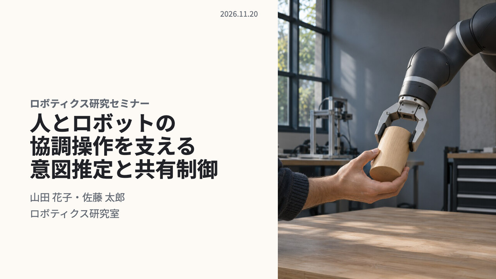
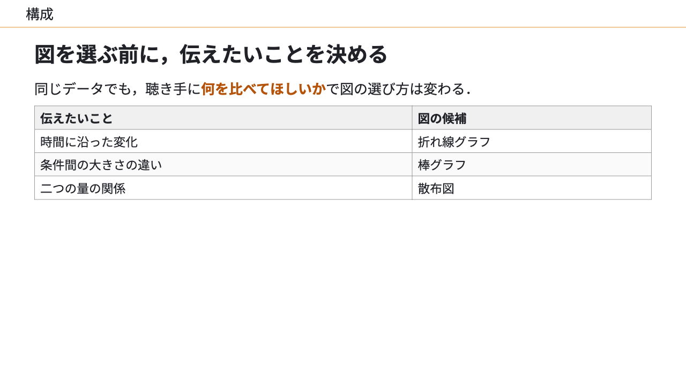
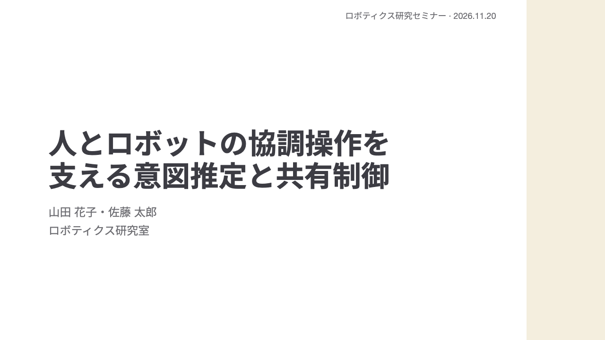
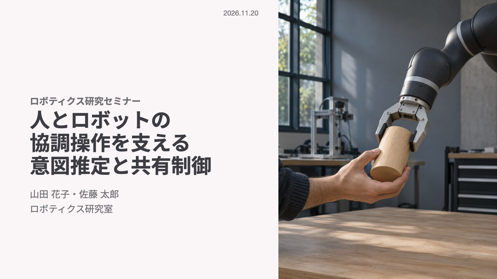
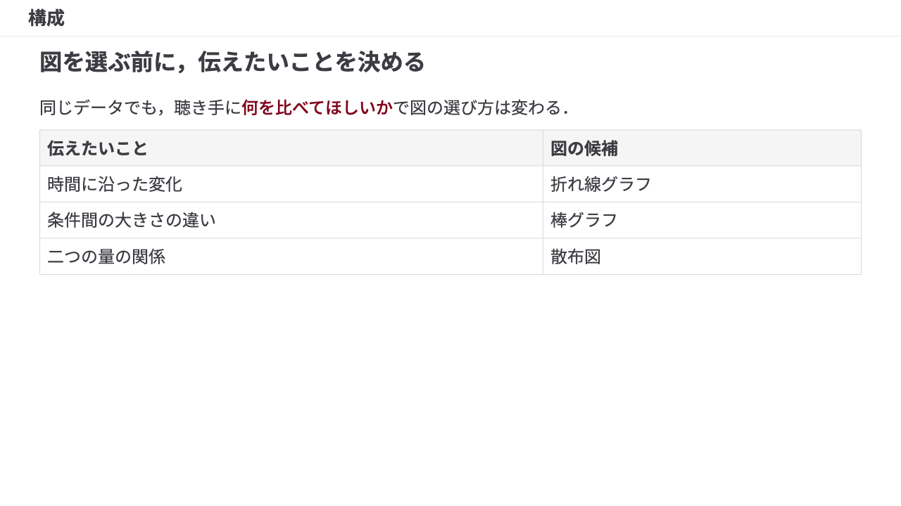
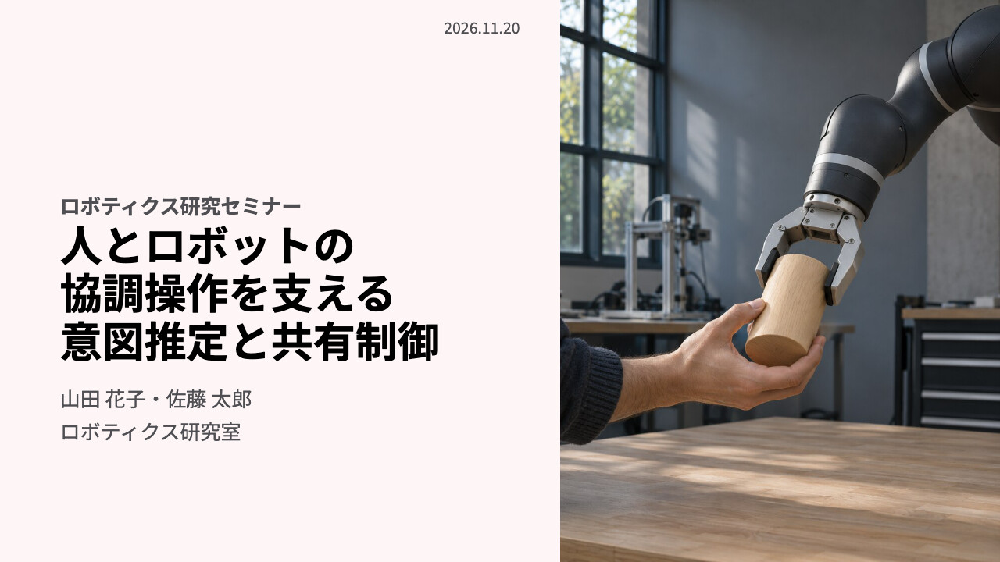
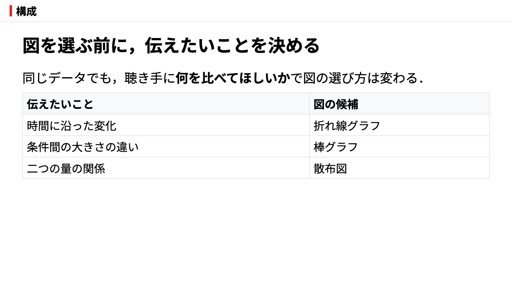

# MarpAgent Designs

Available designs:

| Design | Source | Generated tokens | Theme |
| :----- | :----- | :--------------- | :---- |
| `lab` | `designs/lab/DESIGN.md` | `themes/src/_generated/lab-design-tokens.css` | `theme: lab` |
| `muji` | `designs/muji/DESIGN.md` | `themes/src/_generated/muji-design-tokens.css` | `theme: muji` |
| `toshiba` | `designs/toshiba/DESIGN.md` | `themes/src/_generated/toshiba-design-tokens.css` | `theme: toshiba` |

Create another design with:

```bash
marpx --theme-new <name> --source-url <url> --no-build
```

Then replace the scaffolded `designs/<name>/DESIGN.md` notes with the extracted
design rationale and token values before compiling the theme.

Designs and surfaces are separate concepts:

- A **design** owns visual identity, tokens, and rationale.
- A **canvas family** owns output form and aspect ratio, such as `16:9`, `4:3`,
  A-series paper, or custom pixels.

Paper layout components are shared by the `lab`, `muji`, and `toshiba` design
implementations, not exposed as a separate design system or Marp theme.

### Cover and body styles

Use `theme:` for the deck identity and `<!-- _class: title -->` for its
standard cover. A cover can opt into a shared layout while the deck uses
the selected theme's typography and colors.

| Cover class | Layout |
| :--- | :--- |
| `title cover-plain` | Left-aligned title without the standard cover decoration. |
| `title cover-photo` | Title and author information on the left, full-height photo on the right. |

Use an H1 for the title, an optional paragraph before it for the event name,
and a paragraph or `.author` block below it for the presenter and affiliation.
For `cover-photo`, add a standalone image anywhere on the cover. A portrait
image with the subject near the center works well with the panel's crop.

```html

```

Set `object-position` on the image to adjust the crop when needed.

New themes have independent `_cover.css` and `_body.css` files alongside
their entry stylesheet. Shared layout rules provide columns, figures and paper
canvases. Put identity tokens in DESIGN.md and keep cover-only placement in
the cover stylesheet. New themes start with a neutral design.

## Cover and body gallery

| Theme | Standard cover · `title` | Plain cover · `title cover-plain` | Photo cover · `title cover-photo` | Body |
| :--- | :--- | :--- | :--- | :--- |
| `lab` | [](previews/lab-title.png) | [](previews/lab-cover-plain.png) | [](previews/lab-cover-photo.jpg) | [](previews/lab-body.png) |
| `muji` | [](previews/muji-title.png) | [](previews/muji-cover-plain.png) | [](previews/muji-cover-photo.jpg) | [](previews/muji-body.png) |
| `toshiba` | [](previews/toshiba-title.png) | [](previews/toshiba-cover-plain.png) | [](previews/toshiba-cover-photo.jpg) | [](previews/toshiba-body.png) |

Open a thumbnail for the 1280 × 720 render. The
[shared manuscript](previews/slide.md) shows the standard, plain, and photo
covers followed by a body slide. The standard and photo covers set the same
Japanese research title. The photo is a generated illustration for comparison.

To try the example, run `npm run marpx -- designs/previews/slide.md --overview`
from the repository root. For the other rows, set the manuscript's frontmatter
to `theme: muji` or `theme: toshiba`. Export with
`npm run marpx -- designs/previews/slide.md --images png --output out/cover-body.png`.
The saved previews use Chromium at 1280 × 720 with Noto Sans JP available.
