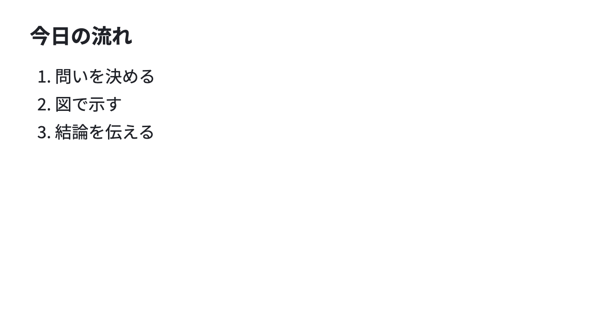
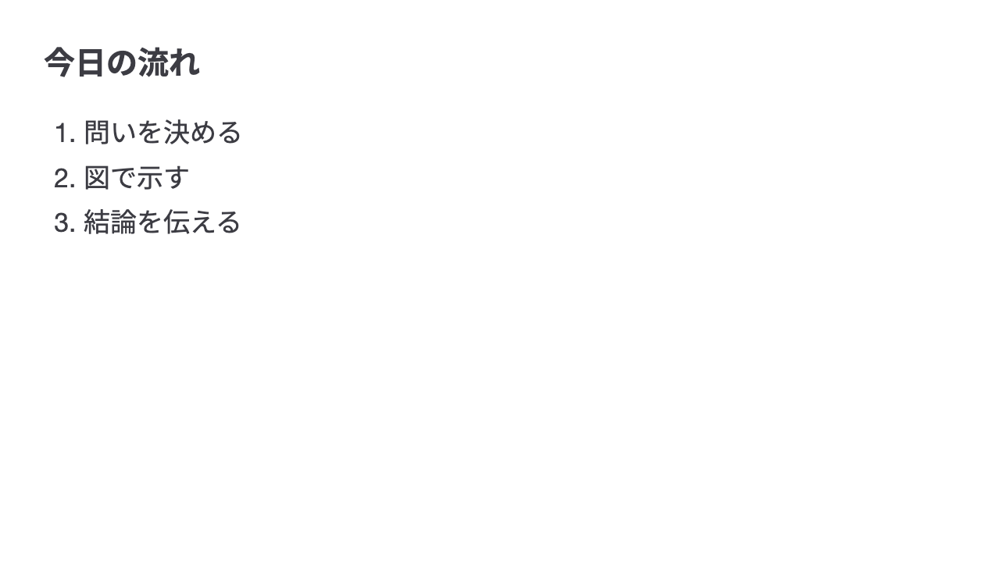
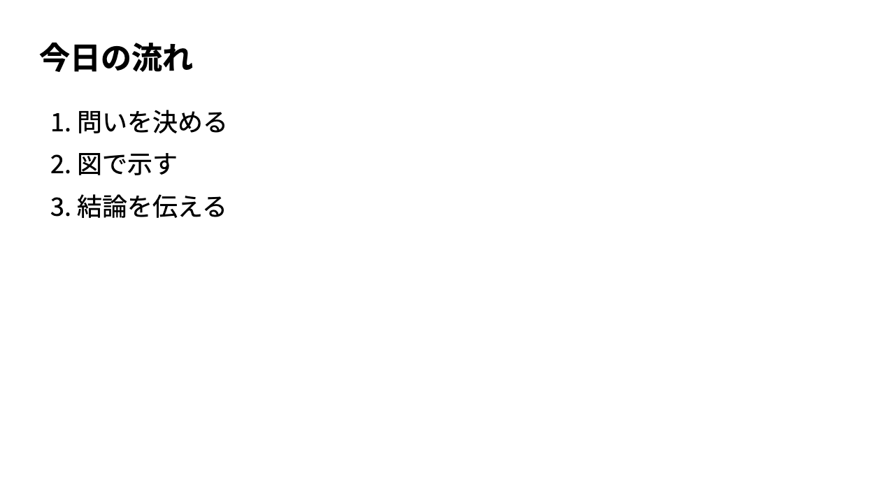
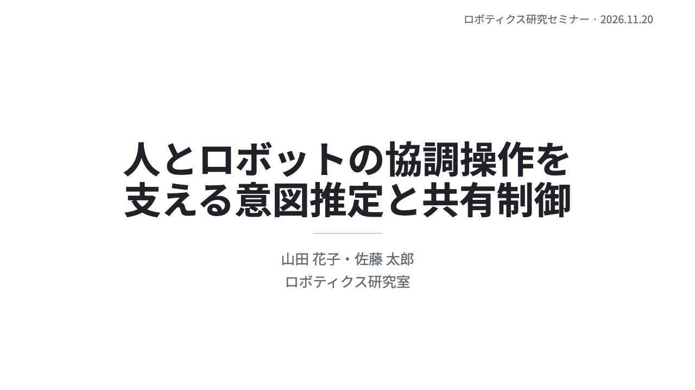
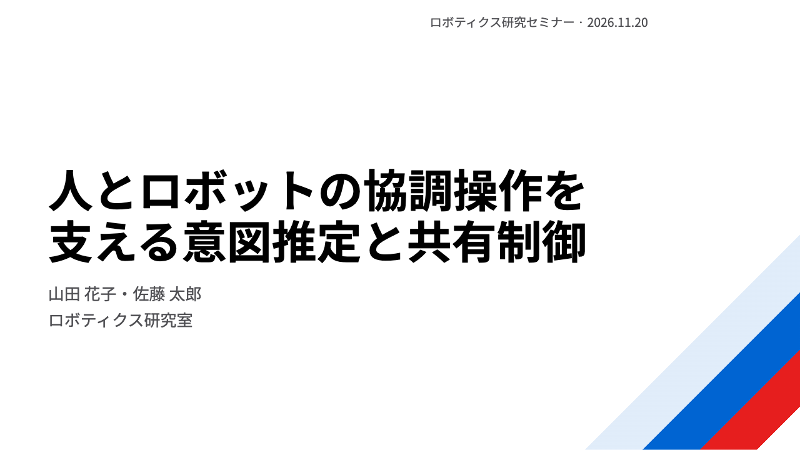

# MarpAgent Designs

Available designs:

| Design | Source | Generated tokens | Theme |
| :----- | :----- | :--------------- | :---- |
| `lab` | `designs/lab/DESIGN.md` | `themes/src/_generated/lab-design-tokens.css` | `theme: lab` |
| `muji` | `designs/muji/DESIGN.md` | `themes/src/_generated/muji-design-tokens.css` | `theme: muji` |
| `toshiba` | `designs/toshiba/DESIGN.md` | `themes/src/_generated/toshiba-design-tokens.css` | `theme: toshiba` |

## Automatic contents gallery

The [sample manuscript](contents/slide.md) puts `<!-- _toc: true -->` on its first slide. The four body slides use three distinct header runs. The two consecutive slides about choosing a question contribute a single entry, followed by the sections on figures and conclusions. The slide heading is ordinary Markdown, and MarpAgent generates the numbered list beneath it.

| `lab` | `muji` | `toshiba` |
| :--- | :--- | :--- |
| [](contents/lab-contents.png) | [](contents/muji-contents.png) | [](contents/toshiba-contents.png) |

The generated entries are 36 px in lab and toshiba and 34 px in MUJI. A headerless contents page leaves 48 px above the heading. Open a thumbnail for the 1280 × 720 render. Run `npm run marpx -- designs/contents/slide.md --overview` to see the list alongside the pages that supply its entries. Change the frontmatter `theme:` value to reproduce each column. The previews use Chromium with Noto Sans JP available.

## Creating a design

Create another design with:

```bash
marpx --theme-new <name> --source-url <url> --no-build
```

Then replace the scaffolded `designs/<name>/DESIGN.md` notes with the extracted
design rationale and token values before compiling the theme.

Designs and surfaces are separate concepts:

- A **design** owns visual identity, tokens, and rationale.
- A **canvas family** owns output form and aspect ratio, such as `16:9`, `4:3`,
  A-series paper, or custom pixels.

Paper layout components are shared by the `lab`, `muji`, and `toshiba` design
implementations, not exposed as a separate design system or Marp theme.

### Cover and body styles

Use `theme:` for the deck identity. On the cover, `<!-- _class: title -->`
uses the theme cover. Switch just that page to `<!-- _class: title cover-plain -->`
for a left-aligned cover without a title rule. Both use the same title,
author and affiliation markup. The body pages keep their theme.

New themes have independent `_cover.css` and `_body.css` files alongside
their entry stylesheet. Shared layout rules provide columns, figures and paper
canvases. Put identity tokens in DESIGN.md and keep cover-only placement in
the cover stylesheet. New themes start with a neutral design.

## Cover and body gallery

| Theme | Standard cover · `title` | Plain cover · `title cover-plain` | Body |
| :--- | :--- | :--- | :--- |
| `lab` | [](previews/lab-title.png) | [](previews/lab-cover-plain.png) | [](previews/lab-body.png) |
| `muji` | [](previews/muji-title.png) | [](previews/muji-cover-plain.png) | [](previews/muji-body.png) |
| `toshiba` | [](previews/toshiba-title.png) | [](previews/toshiba-cover-plain.png) | [](previews/toshiba-body.png) |

Open a thumbnail for the 1280 × 720 render. Each row uses the [same three-slide manuscript](previews/slide.md). The first two slides have identical text. On the second slide, `cover-plain` groups the title and subtitle at the left, vertically centers them, and removes the theme's cover decoration. Type and color still come from the selected theme. The third slide compares a context header, a heading, emphasis, and a table.

To try the example, run `npm run marpx -- designs/previews/slide.md --overview` from the repository root. For the other rows, set the manuscript's frontmatter to `theme: muji` or `theme: toshiba`. Export the three pages with `npm run marpx -- designs/previews/slide.md --images png --output out/cover-body.png`. The saved previews use Chromium at 1280 × 720 with Noto Sans JP available.

On regular body slides, lab and toshiba use 44 px page headings, 32 px body text and 28 px tables. MUJI uses 40, 30 and 27 px respectively. A context header directly followed by a page heading leaves a 24 px gap in all three designs.
