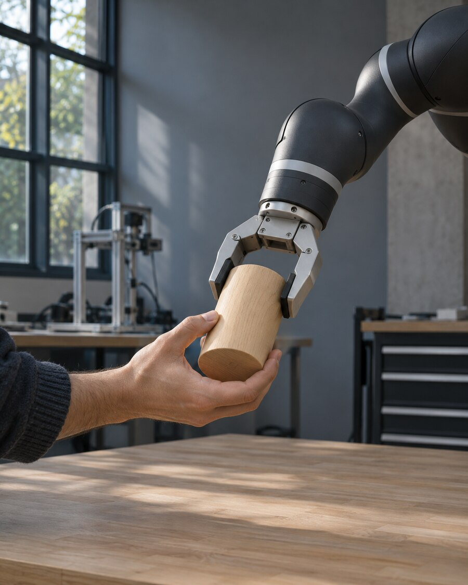

<!-- _class: title -->
<!-- _header: ロボティクス研究セミナー · 2026.11.20 -->

# 人とロボットの協調操作を支える意図推定と共有制御

山田 花子・佐藤 太郎

ロボティクス研究室

---

<!-- _class: title cover-plain -->

# 発表資料のつくり方

研究発表ワークショップ

---

<!-- _class: title cover-photo -->
<!-- _header: 2026.11.20 -->

ロボティクス研究セミナー

# 人とロボットの協調操作を支える意図推定と共有制御

山田 花子・佐藤 太郎

ロボティクス研究室

---

<!-- _header: 構成 -->

## 図を選ぶ前に，伝えたいことを決める

同じデータでも，聴き手に**何を比べてほしいか**で図の選び方は変わる．

| 伝えたいこと | 図の候補 |
| :--- | :--- |
| 時間に沿った変化 | 折れ線グラフ |
| 条件間の大きさの違い | 棒グラフ |
| 二つの量の関係 | 散布図 |
