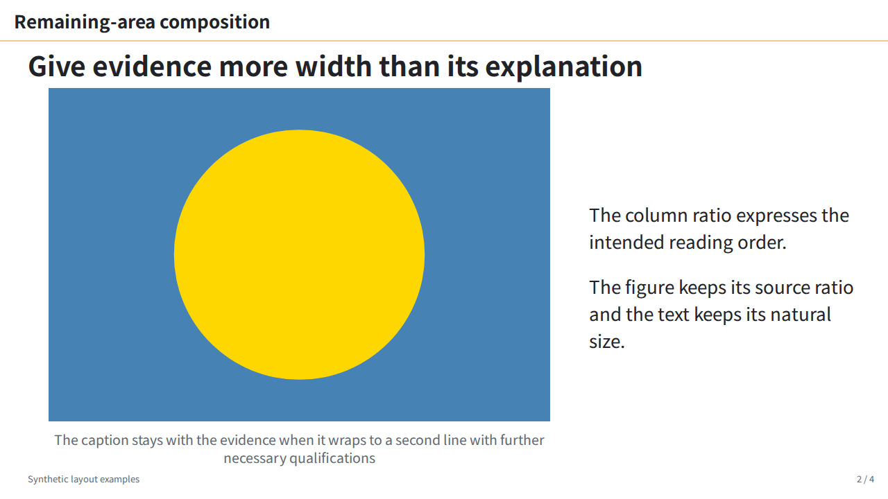
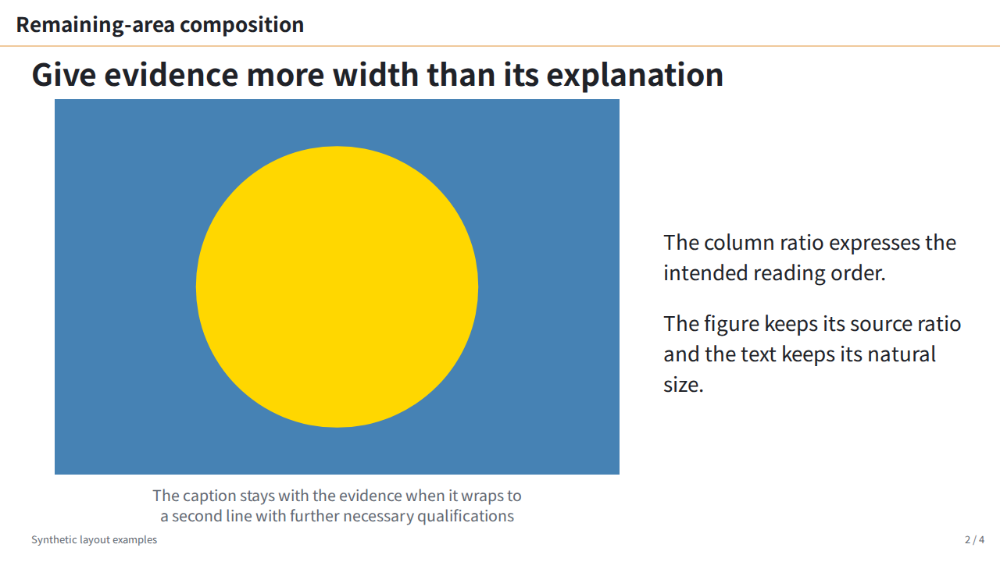
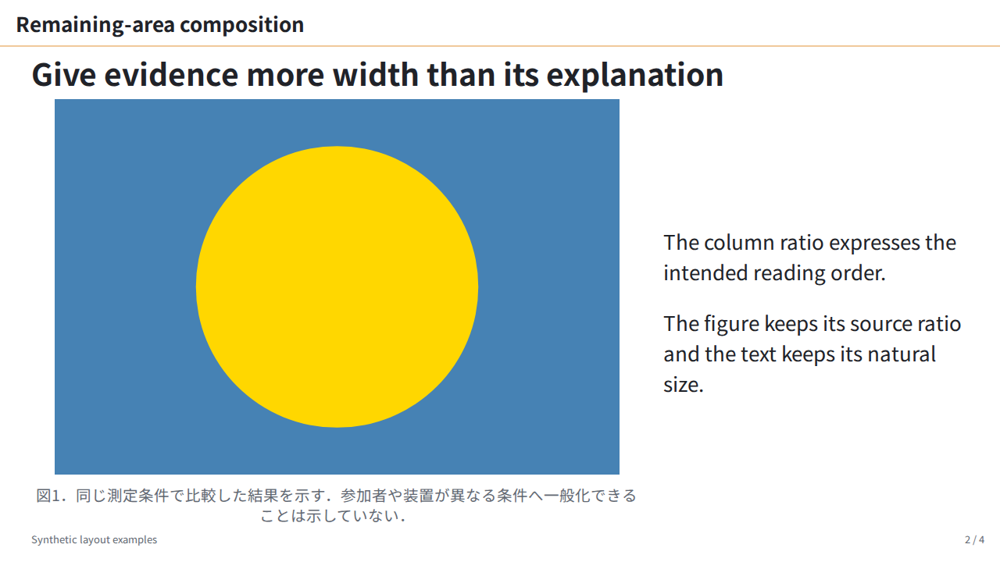

# ISS-0049 — caption wrapping feedback

日本語のcaptionには，従来からBudouXが文節の区切りを挿入する．今回の指摘では，区切りを守るだけでなく複数行の長さも均したいため，paper以外のlabの`figcaption`へ`text-wrap-style: balance`を追加した．`.nobr`や`white-space: nowrap`を維持するため，wrap modeを置き換えるshorthandは使わない．局所的な`text-wrap-style: auto`で従来の詰め方へ戻せる．本文の折返し方式は変更しない．

| 比較 | before | after |
| :--- | :--- | :--- |
| 英語：既存body fixtureの表示2/4 |  |  |
| 日本語：同じ図と構図でcaptionだけ置換 |  |  |

beforeは`9836b76`，afterは`94eb340`のCSS．[body-layout原稿](../../../fixtures/body-layout-slide.md)と素材は変更せず，日本語条件ではcaptionの英文だけを[summary.json](summary.json)に記載した日本語へ置換する．同一言語の新旧で文章・ページ番号・図・本文の順序は同じである．

| 計測値 | before | after |
| :--- | ---: | ---: |
| 英語の短い行／長い行の幅 | 0.310 | 0.958 |
| 日本語の短い行／長い行の幅 | 0.258 | 0.942 |
| 行数（両言語） | 2 | 2 |
| 日本語の文節区切り | 12 | 12 |

幅は文字ごとのDOM Rangeから算出し，空白・文節用のゼロ幅空白を除く．2組とも全文・文節区切りと図／captionのbox座標・寸法が一致した．今回は必要行数が変わらず，図の高さも同じである．mainは変更前後の画像を目視し，均された行と留保の保持を確認した．任意の原稿で行数・図の寸法が不変になるという保証ではない．

2026-10-21，Linux WSL2 x64，Node25.6.0，Marp Core5.0.2，Playwright1.58.2，Chromium145.0.7632.6，1280×720，DPR1．#54と同じNoto Sans JPの400/700を明示登録し，外部font要求を遮断した．CDPでcaptionの実fontがNotoSansJP-Regularであることを確認した．font・入力・CSS・PNGのSHA-256と測定値はsummary.jsonに保存し，font本体は同梱しない．

回帰テストは，変更前に明暗2件の行幅比が約0.307で失敗した．変更後，固定fontによるChromiumとFirefoxの計8件が成功した．日本語のBudouX，`.nobr`，明示nowrap／auto，captionの収まり，paperと他テーマの独立性を含む．Firefoxの初回は日本語fontが読み込まれず1件失敗したため，明示登録して再実行した．macOS/Safari実機は未確認である．

[capture.cjs](capture.cjs)は実行した比較harness．保存CSSと現在revisionの原稿を読むため，この証跡を含むrevisionで依存と同じfontを用意して実行する．入力・fontのhashがsummary.jsonと一致することを先に確認する．共有環境ではbrowser lockを使用する．

```sh
FONTCONFIG_FILE=path/to/fonts.conf flock path/to/browser.lock \
  node docs/evidence/ISS-0049-caption-feedback/capture.cjs \
  path/to/fonts out/caption-replay
```

4枚のPNG，計測JSON，fontと素材を内包した確認用HTMLを出力する．HTMLの描画は閲覧側のbrowserに依存する．ブラウザー側の機能と長文時の制限は[MDNのtext-wrap説明](https://developer.mozilla.org/en-US/docs/Web/CSS/Reference/Properties/text-wrap)を参照する．非対応環境では従来の折返しとなる．
