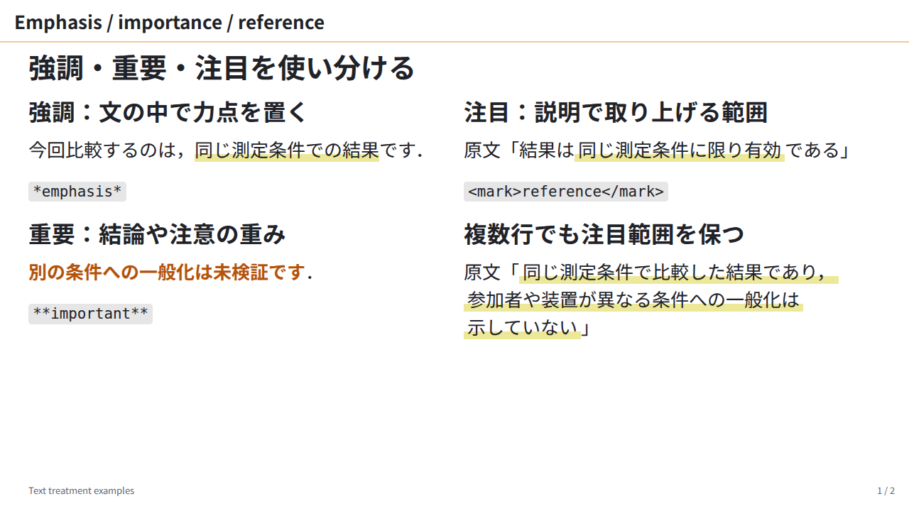
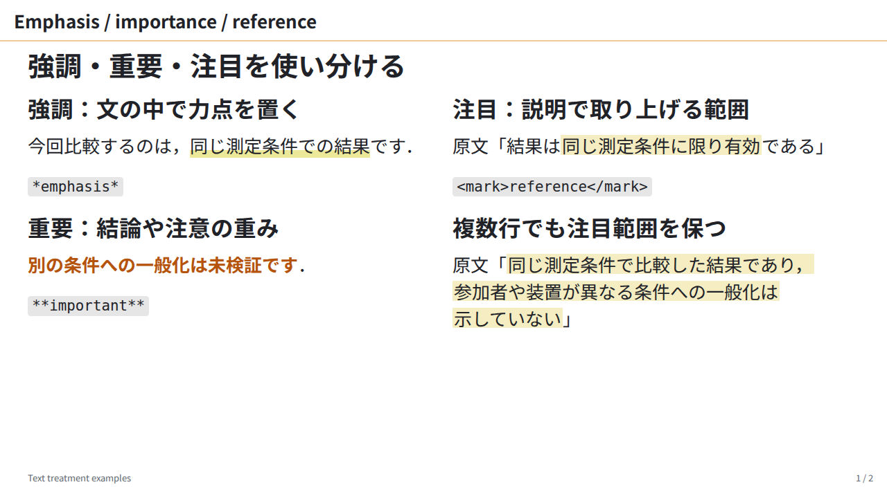
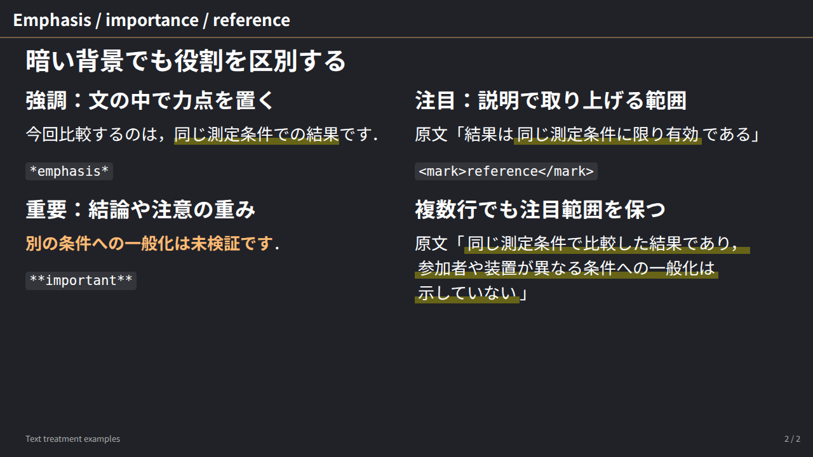
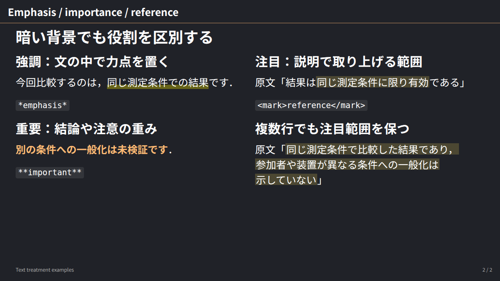

# ISS-0049 — emphasis and contextual highlighting

利用者が承認した3種類の役割を，実際のlabテーマへ反映した比較である．emは細い帯，strongは色付き太字，markは引用・説明で注目する範囲の淡い背景とする．`.marker`は既存原稿の互換用に保持し，新規原稿では推奨しない．[採用判断](../../decisions/ADR-0011-separate-lab-emphasis-from-contextual-highlighting.md)と[利用説明](../../lab-refinement.md#emphasis-and-contextual-highlighting)を参照する．

| 条件 | before：全種類が細い帯 | after：markを淡い背景へ |
| :--- | :--- | :--- |
| 明るい背景 |  |  |
| 暗い背景 |  |  |

新しい[lab-emphasis-slide.md](../../../fixtures/lab-emphasis-slide.md)を両条件に使用した．旧fixtureと過去画像は変更しない．beforeは`27c5370`のCSS，afterは担当`dd1367c`を統合した`8e18b1f`のCSS．全文とページ番号は2/2一致した．mainが新旧4枚を目視し，em／strong／markの区別，明暗の文字と複数行の留保を確認した．

markの中央80%を塗り，上下10%ずつは透明にする．37pxのinline fragmentでは背景が29.6pxになり，この原稿の連続行の背景間は9.4px．emの11.1pxの帯と区別できる．文字weight400，本文色継承，inline／cloneを保ち，左右paddingは0.08emとした．背景寸法はDOM rectとcomputed gradientから算出したCSS pxであり，PNGの画素面積測定ではない．

色と左右paddingの正本はDESIGN.md．明背景はrgba(215,182,0,0.24)，暗背景はrgba(250,220,90,0.2)を指定し，既存exporterの形式で`#d7b6003d`／`#fadc5a33`へ生成する．CSSOMでは指定rgbaと同じ正規化表示になることを回帰で確認した．em・strong・caption balanceと互換用.markerを維持し，paper・muji・toshiba・共有CSSは変更していない．

条件は2026-10-21，Linux WSL2 x64，Node25.6.0，Marp Core5.0.2，Playwright1.58.2，Chromium145.0.7632.6，1280×720／DPR1．Noto Sans JP400/700の固定ファイルを登録し，font本体は同梱しない．CDPでem／markの実fontがNotoSansJP-Regular，strongがNotoSansJP-Boldであることを確認した．入力・CSS・font・PNGのhashと測定値を[summary.json](summary.json)へ保存した．

担当は中央80%の背景を期待する回帰でRED（旧11.1px，期待29.6px）→GREENを確認した．関連unit27件，browser16件成功．明暗・named scheme10組・文字色継承・局所上書き・paper・他テーマを含む．mainでbrowser全体119件成功，既存Firefox native touch1件だけskip，新しいfixture2ページのstrict描画はmeasured／finding0．テーマ再生成の差分なし．[検証manifest](../integration-2026-10-21/emphasis-roles-validation.json)へ各段階を区別して記録した．Safari／macOS実機の自動検証は行っていない．

[capture.cjs](capture.cjs)は実行した比較harness．この証跡を含むrevisionと依存・Chromiumを用意し，summary.jsonと同じhashのfontで実行する．出力は明暗PNG，計測JSON，素材とfontを内包した確認用HTMLである．

```sh
FONTCONFIG_FILE=path/to/fonts.conf flock path/to/browser.lock \
  node docs/evidence/ISS-0049-emphasis-roles/capture.cjs \
  after path/to/fonts out/emphasis-replay
```

`before`も同じfontで実行する．別fontやbrowserで同じ折返し・寸法になることは保証しない．確認用HTMLのCSS import除去はCSS parserを使用し，URL内のセミコロンを誤って扱わない．同じ問題があった過去のcaption確認用HTMLも修正し，その4枚の保存PNG hashと測定値が変わらないことを確認した．
