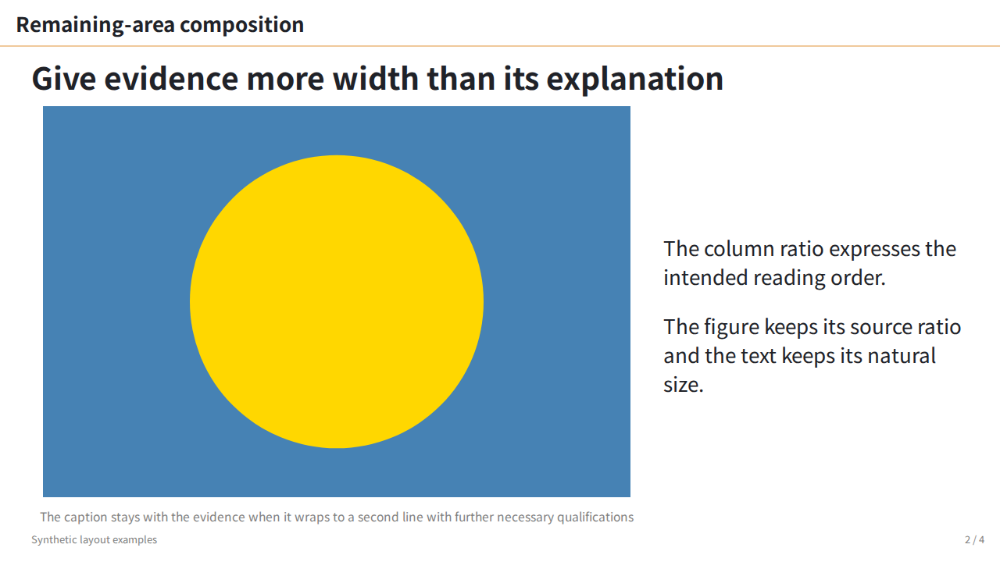
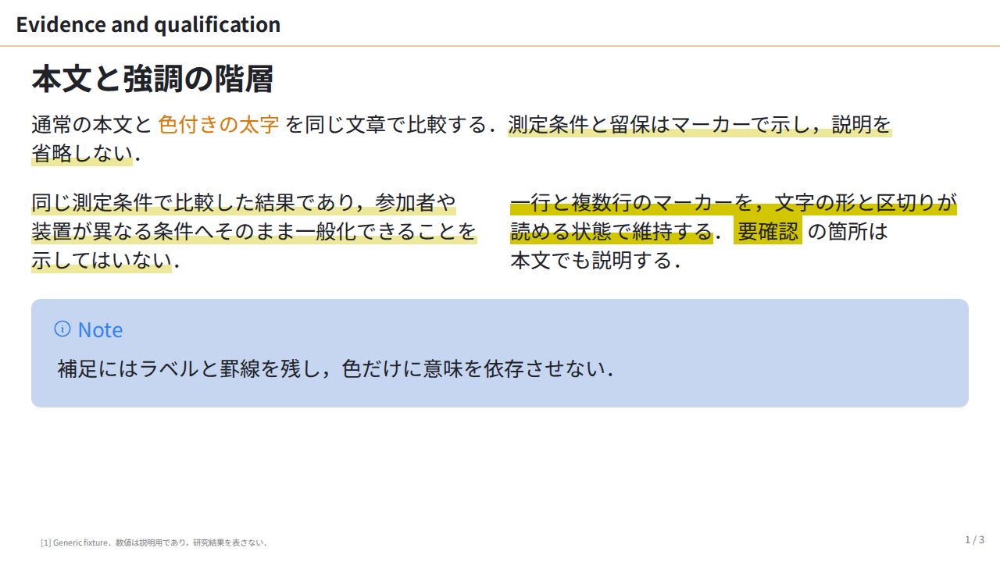

# ISS-0049 — lab の既定更新の比較

before は `1f303a5` の plain `theme: lab`，after は実装 `9bd58e1` の plain `theme: lab`．同じ内容・構図と font で比較し，代表2組だけを保存した．[利用説明](../../lab-refinement.md) と [theme contract](../../theme-contract.md#lab-slide-typography) から参照する．過去の [opt-in 比較](../ISS-0049-lab-refinement/README.md) の画像・数値・条件は変更していない．

| 同じ原稿 | before：plain lab | after：plain lab |
| :--- | :--- | :--- |
| `.body` 二列図の caption：1行 → 2行．説明の留保を保持 |  |  |
| 日本語の強調：着色 strong 500 → 700．一行・複数行マーカーを保持 |  |  |

## 条件と結果

- 2026-10-21，Linux WSL2 x64，Node `v25.6.0`，Marp Core `5.0.2` / CLI `4.5.1`，Playwright `1.58.2`，Chromium `145.0.7632.6`．canvas / viewport 1280×720，DPR 1．browser 実行は共有 flock で直列化した．
- 両条件とも改名後の plain 原稿を同じ engine で描画した．before は `1f303a5` の CSS，after は `9bd58e1` の CSS を固定する．旧 active fixture の class 付き原稿をそのまま before とした比較ではない．原稿 hash は `inputs` に記録した．
- #54 と同じ Noto Sans JP の400/700ファイルを全条件で使用した．font の取得元は [#54 の conditions](../../../fixtures/layout-baselines/baseline/conditions.json) にあり，[summary.json](summary.json) に個別 SHA-256 と使用情報を保存した．font 本体は含めない．比較では Google Fonts の要求を遮断し，ローカルの400/700 faceを明示登録した．SVG 内部の日本語にも同じ fontconfig を使用した．過去の variable font による比較と数値を混ぜない．
- 代表 slide 内の段落・strong・captionを CDP で検査した．変更前の strong は `NotoSansJP-Regular`，変更後は実際の `NotoSansJP-Bold` を使用．本文と caption は `NotoSansJP-Regular`．computed family だけによる使用判定ではない．
- #55 `.body` 4ページ，active typography 4ページ，#54 baseline 14ページ，既存 example 全15ページの計37ページを比較し，本文は37/37一致．wrap 差は `.body` ページ2の caption 1→2行と，#54 ページ4の caption 2→3行．段落・見出し・表セルの wrap 差はなかった．
- `.body` ページ2では caption 高22px → 50.6875px，media 高501.25px → 481.765625px．media 幅782.671875px，contain，中央位置，group と列順を保持した．本文行高は `normal` → 39px，caption は15.6px → 19.5px / 行高25.35px．色付き強調は実際の700へ変わり，脚注は10.4px → 14pxになる．これらは文字による必要高さの変更であり，body/header-gap の再定義ではない．
- 代表2組は，同じ旧 CSS に旧 `lab-refined` を付けた追加比較とも画素一致した．その旧 class は historical CSS の同等性確認だけに用い，after には付けていない．全37ページの画素同等性は主張しない．
- 全条件で overlap / small text / media error / render error は0．`.body` と typography fixture は clipping 0．#54 の `.body` なし縦長図（ページ6）は新旧とも clipping が残り，最大86px → 83px．ラベルと media は同じ箇所であり，新規の clipping はない．未解消例として保持し，解消したとは扱わない．
- plain lab の700を期待した同じテストで RED（実測500）→ GREENを確認した．関連 unit 52件 + rendered unit 22件，browser 46件が成功，skip 0．strict は typography，body 16:9，body 4:3，Core 5 の4条件すべて measured / finding 0 / 終了0．full gate と最終統合は main が担当する．

Codex が上の4枚を比較し，caption の収まり，太字，マーカー，脚注と留保を視覚確認した．この比較は理解度・科学的正しさ・未検査の原稿の収まりを示す実験ではない．

## Pagination の照合

代表の emphasis は新旧とも `1 / 3`，body-caption は新旧とも `2 / 4`．typography 原稿は先頭表紙を `_paginate: skip` で除くため，原稿2枚目が表示1枚目となる．body 原稿では4枚すべてを数える．

before CSS は `git show 1f303a5:themes/lab.css` と SHA-256 `ad440d77ab874f8538dd449b9bed931609ac377f5a99a0b3fdbf4814f2e53f8e` が一致する．after は `9bd58e1` の CSS と `7df07730347204c56a4086c2a00005d8287d30d0716c43457503fadd1fd6550e` が一致する．両 CSS の `section::after` の pagination 宣言は同一で，番号は `data-marpit-pagination` / `data-marpit-pagination-total` から表示する．

各条件で新しい Marp instance と page を作り，初回の before → after → former opt-in を逆順にして再比較した．37/37ページで属性・computed `::after` 表示が一致し，代表4枚の PNG hash も初回と一致した．確認した保存ファイルでは番号差・CSS 混入・render state による差は再現しなかった．各画像の番号・hash，宣言と照合結果を `pairs` / `paginationCheck` に保存した．画像内容の修正は不要だった．

## 保存物と再実行

PNG は実行結果のバイト列をそのまま保存した．[summary.json](summary.json) は runtime の全結果から必要な測定値を抽出したもの．PNG・font・入力・CSS・元の全結果・harness の hash を含む．旧新 CSS は `styles/*.css.gz` に固定し，元の一時ファイルに依存しない．private 絶対パスと font 本体，全量画像は同梱しない．

[compare.cjs](compare.cjs) は今回実行した harness．本証跡を含む revision（実装親は `9bd58e1`）を別 worktree で使用し，対応 Node・依存・Playwright Chromium と，同じ hash の400/700 font を別途用意する．新しい fontconfig にはその font ディレクトリを登録する．harness は font・原稿・CSS hash を確認し，差があれば停止する．旧証跡の fixture path を現在の path へ書き換えない．

リポジトリルートから，実際の共有 lock・fontconfig・font ディレクトリと未使用の出力先を指定する．

```sh
FONTCONFIG_FILE=<baseline-fontconfig> flock <browser-lock> \
  node docs/evidence/ISS-0049-lab-default/compare.cjs \
  <font-directory> <new-output-directory>
```

出力は代表4枚と全条件の測定 JSON，描画用の原稿・素材と HTML．保存された旧新 CSS を使い，実行時の engine / browser の版を記録する．strict の4条件は同じ font face を明示した作業コピーへ `marpx <copy> -v --strict --format json --report-dir <report>` を適用した結果であり，再実行 harness の比較測定とは分けて `checks.strict` に記録した．
