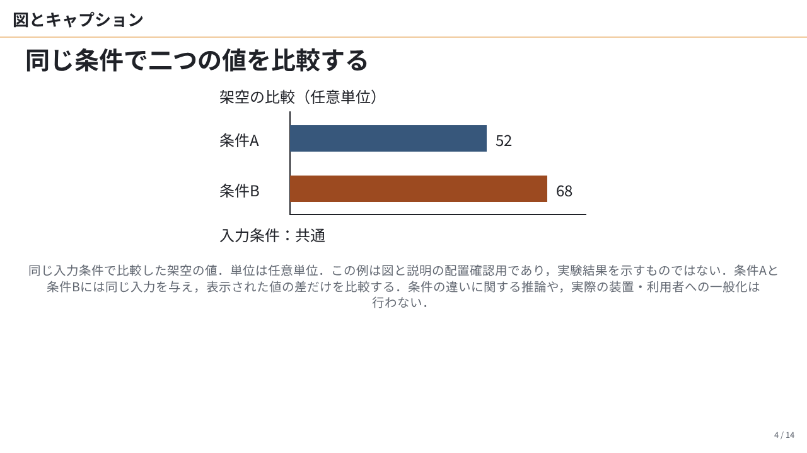
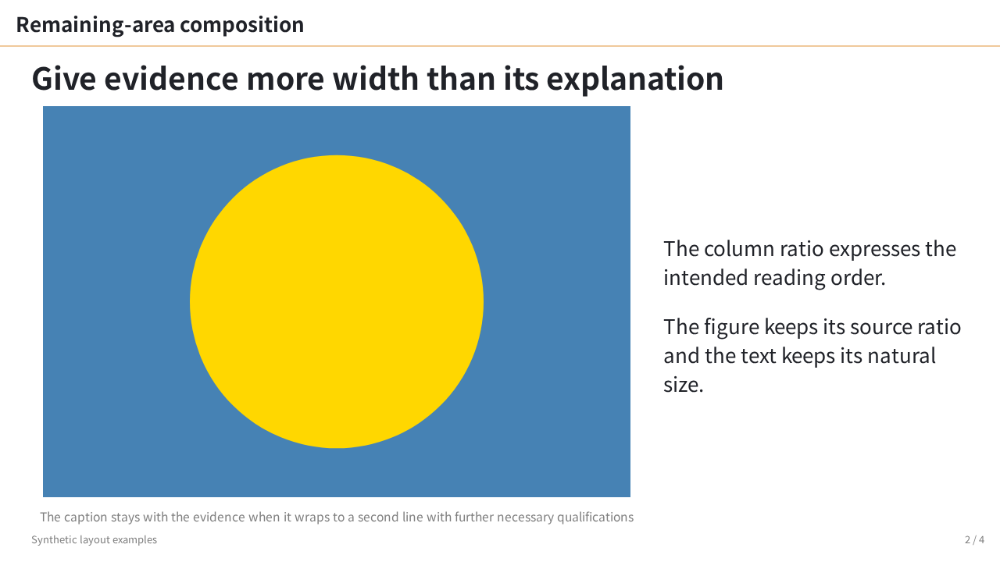
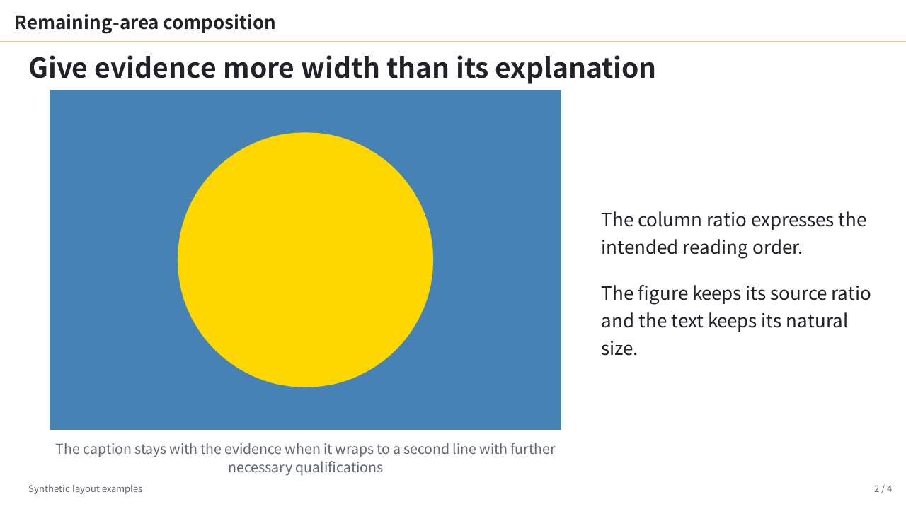
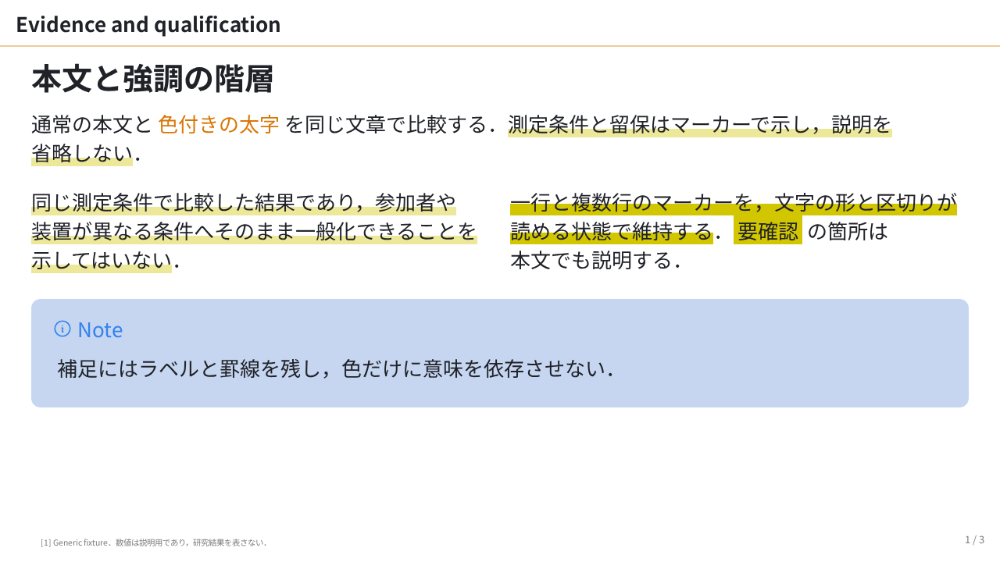
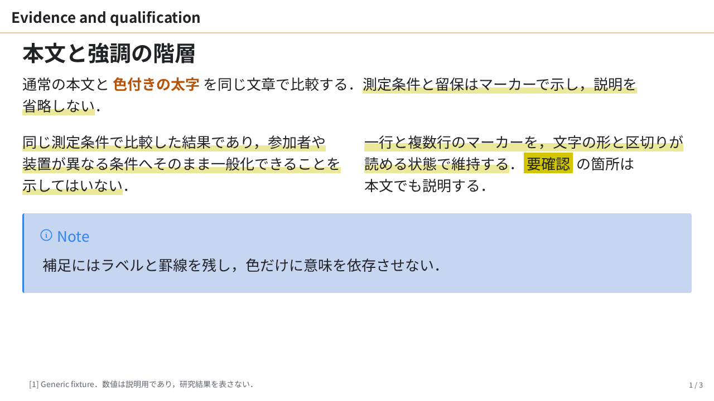

# ISS-0049 — lab の比較証跡

2026-10-21 の既存結果から保存した代表3組．XR-0003（controlled layouts）から参照するための抜粋であり，保存時の再描画・実装変更・テスト変更はない．[比較記録](../../lab-refinement-stable-review.md) と [token・移行方法](../../lab-refinement.md) も参照する．

## 代表画像

画像は既存 PNG のバイト列をそのまま保存した．各ファイルの SHA-256 は [summary.json](summary.json) の `pairs` にある．

| 同じ内容・構図 | 旧 CSS | `lab-refined` |
| :--- | :--- | :--- |
| #54 `figure-caption-wrap` / 4：caption 15.6px・2行 → 19.5px・3行．図の値・単位・留保を保持 |  |  |
| #55 `.body` / 2：caption 1行 → 2行．media 高501.25px → 481.765625pxで収める |  |  |
| lab smoke / 2：着色 strong 500 → 700．一行・複数行の marker と本文を保持 |  |  |

## 条件と測定 summary

- 旧 CSS は `f397ea5`，新 CSS は `0375662` と #55 の安定した配置を統合した `ef0e8db` の記録．正確な CSS を `styles/*.css.gz` に保存し，展開後と圧縮ファイルの hash を summary に記載した．元の作業 branch や一時 CSS ファイルへの依存を残さない．
- 同じ Markdown と参照素材を使用し，旧 CSS，新 CSS の選択無効，新 CSS の選択有効の3条件を比較した．全入力の相対パス・hash と対象ページは `inputs` にある．本文や留保を短縮していない．
- Linux WSL2 x64，Node `v25.6.0`，Marp Core `5.0.2`，CLI `4.5.1`，Playwright `1.58.2`，Chromium `145.0.7632.6`．canvas / viewport は1280×720，DPR 1．
- [Google Fonts の Noto Sans JP](https://github.com/google/fonts/tree/main/ofl/notosansjp) の同じファイルを400/700 faceとして使用．SHA-256 は `c2f3b4d463500a2ddcd3849cded1fceeb9fd6d1c32e6cbecd568453ba50fc68f`．font 本体は同梱しない．Google Fonts のネットワーク要求を止め，比較用 browser の `FONTCONFIG_FILE` だけを設定した．CDP の使用 font 情報は入力・条件ごとの先頭 section を測定したもの．内部名 `Noto Sans JP Thin` は CSS weight を示さない．
- 比較した23ページで，選択無効の新 CSS は23/23画素一致．選択有効でも本文は23/23一致し，wrap 差は上記 caption の2件．`.body` の4構図は clipping / overlap / small text が0．全量画像は同梱しない．
- strict の7条件はすべて実測．5条件は finding 0．#54 ページ6の縦長図だけは新旧とも `content-clipped` が残り，最大86px → 83px．画像280×640pxと列幅は保持されるが，caption の自然幅により figure 外枠は288px → 360px．未解消の境界例であり，改善として数えない．
- 当該作業の unit 45件 / browser 43件は既存結果を引用した．その後，main から #57 の統合済み・配置関連 unit 60件 / browser 46件成功の報告を受けた．本保存操作ではテストを再実行していない．

`summary.json` は既存 comparison / strict JSON から必要な値を抽出したもので，元ファイルと元 harness の hash も含む．絶対パスは `<run-dir>` 等へ一般化した．可読性の視覚確認と機械的な診断を混同せず，理解度・科学的正しさ・すべての原稿の収まりを保証しない．

## 保存した実行 harness

[compare.cjs](compare.cjs) は当時の比較・測定処理を保存し，作業ディレクトリと font の絶対パスを引数・相対パスへ置き換えたもの．入力と font の hash を確認し，保存した旧新 CSS を使う．この一般化した保存版は今回描画実行せず，構文と入力・保存ファイルの整合だけを確認した．

再実行する場合は，対応 Node と checkout の依存・Playwright Chromium・Linux fontconfig を用意し，上記 hash の font を別途用意する．リポジトリルートから新しい出力先を指定する．

```sh
node docs/evidence/ISS-0049-lab-refinement/compare.cjs path/to/NotoSansJP.ttf out/ISS-0049-replay
```

並行する browser 作業がある場合は同じ共有ロックで直列化する．出力先には比較原稿・素材，CSS，font の作業コピー，測定 JSON と画像を生成する．再実行時の engine・依存・browser の版も記録するため，当時の環境と一致しているか確認できる．strict の7条件と #56 の class collector の確認は summary と比較記録に保存した結果である．
