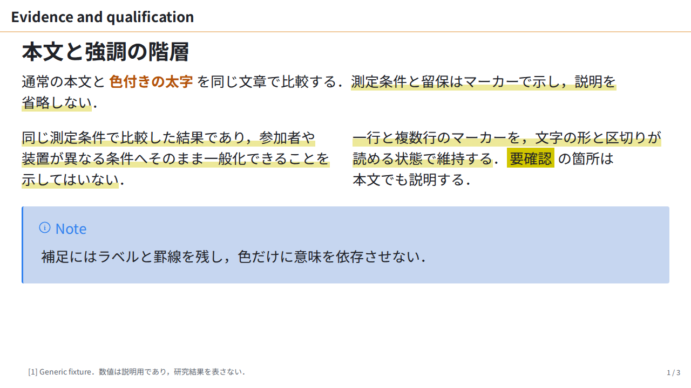
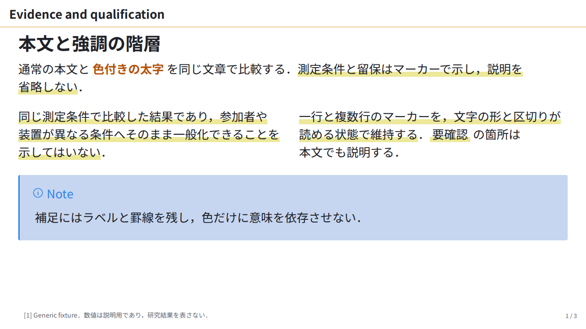
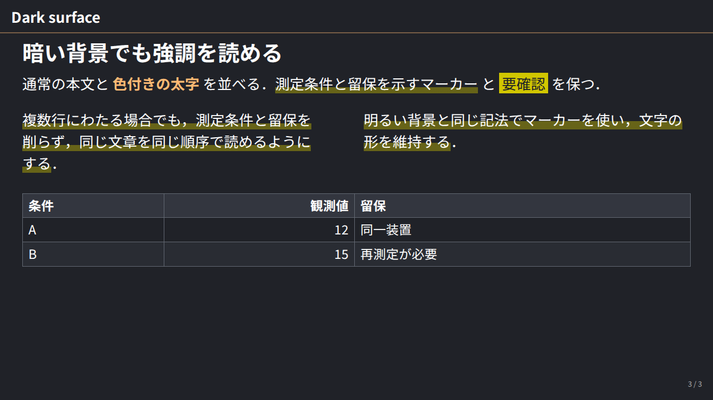
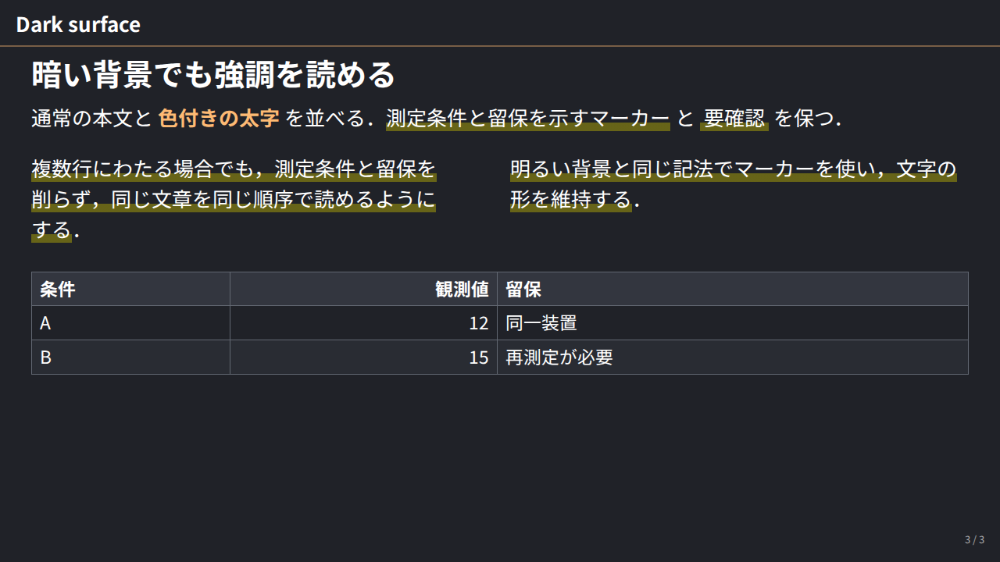

# ISS-0049 — marker feedback

PR62 の見た目レビューで指摘された，表示1枚目（原稿2枚目）右列のマーカーを比較した．before は `9836b76`，after は marker 実装 `b4938ca`．同じ `fixtures/lab-typography-slide.md` と固定 font を使用し，caption・engine・原稿は変更していない．[Marker feedback の説明](../../lab-refinement.md#marker-feedback) も参照する．

| 内容 | before | after |
| :--- | :--- | :--- |
| 表示1/3：一行・複数行の帯と「要確認」 |  |  |
| 表示3/3：暗い背景の文字色と帯 |  |  |

原因は文字の weight ではなく背景の形だった．CDP では `em` / `.marker` / `mark` がすべて `NotoSansJP-Regular`，computed weight 400．strong は新旧とも実際の `NotoSansJP-Bold`・700だった．

| 明るい背景の実測 | before | after |
| :--- | ---: | ---: |
| inline fragment 高 | 37px | 37px |
| `em` の帯 | 11.1px | 11.1px |
| `.marker` の帯 | 14.8px | 11.1px |
| `mark` の背景高 | 37px（全面） | 11.1px |
| 上の行の帯と `mark` の背景の隙間 | 2px | 27.9px |

帯の高さ・隙間は `getClientRects()` と computed gradient stop から計算した CSS px．ラスタ画像の塗りを直接数えた値ではない．変更前にも実際の背景の交差はなかったが，隙間2pxと全面の濃い塗りがつながって見える状態を再現した．Codex が4枚を目視し，変更後の帯が均一で，明暗の文字と留保を読めることを確認した．本文・pagination・fragment 座標・font 使用情報・strong の style と位置は新旧で一致した．

`.marker` と `mark` は既存の黄色を下30%・色の不透明度40%の帯で描画し，`mark` は本文色を継承する．`em` の配色，文字 weight，行高，padding，clone は維持する．局所的な `background` / `color` 指定は上書きできる．paper と muji/toshiba は従来の帯と全面 mark を保つ．

条件は2026-10-21，Linux WSL2 x64，Node `v25.6.0`，Marp Core `5.0.2` / CLI `4.5.1`，Playwright `1.58.2`，Chromium `145.0.7632.6`，1280×720，DPR 1．[#54 の400/700 font](../../../fixtures/layout-baselines/baseline/conditions.json) と同じ実ファイルを全条件で登録し，Google Fonts の要求は遮断した．SVG 用にも指定の fontconfig を使い，共有 browser lock で直列化した．font 本体は同梱しない．

TDD の RED は帯14.8pxと基準11.1pxの不一致．修正後は browser 7件・unit 27件が成功し，skip 0．既存 typography・strong・16:9 / 4:3 body，局所上書き，paper，他テーマ，invert・名前付き scheme を含む．design lint は全 design error / warning 0，token 一致を確認した．全体 gate・caption との統合確認は main が担当する．

[summary.json](summary.json) に入力・CSS・PNG・font・元の実行結果と harness の SHA-256，明暗の実測と使用 font を保存した．画像は元 PNG のバイト列をそのまま保存し，過去の証跡を上書きしていない．CSS は小さな圧縮 snapshot に固定した．

[capture.cjs](capture.cjs) は実行した一時 harness のパスを引数・相対パスにし，保存 CSS を読むようにした版．この保存版は構文・hash 整合を確認し，描画の再実行はしていない．本証跡を含む revision で依存と Chromium，同じ hash の font を用意し，リポジトリルートから次の形で実行できる．実際の共有 lock と fontconfig を指定する．

```sh
FONTCONFIG_FILE=path/to/fonts.conf flock path/to/browser.lock \
  node docs/evidence/ISS-0049-marker-feedback/capture.cjs \
  before path/to/fonts out/marker-replay
```

`after` も同じ入力・font と出力先で実行する．版と hash を照合してから画像を比べる．font の版・fallback・原稿の上書きが変わる場合の描画は，この比較の保証範囲に含まない．
