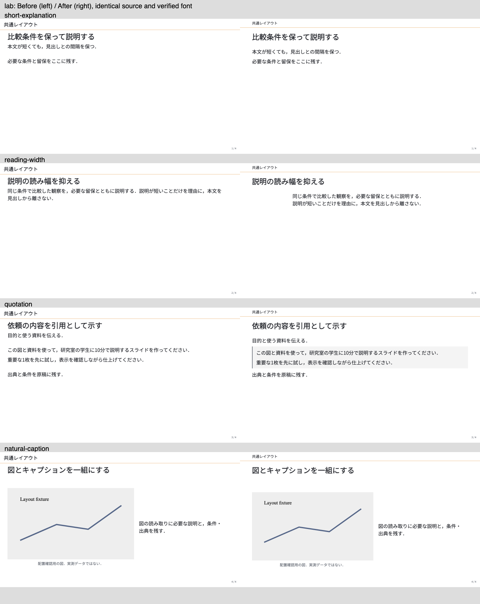
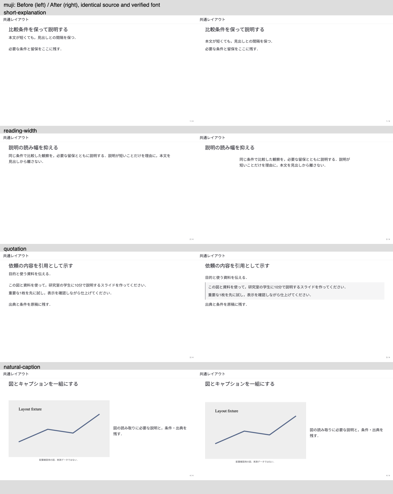
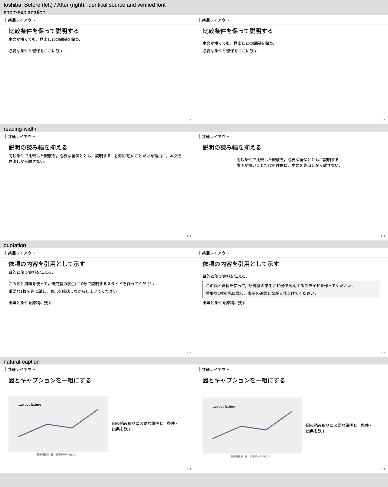
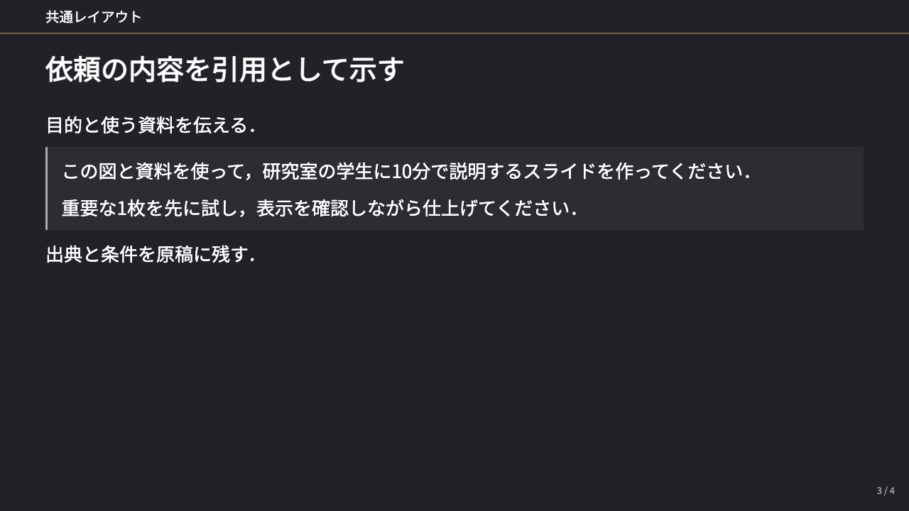
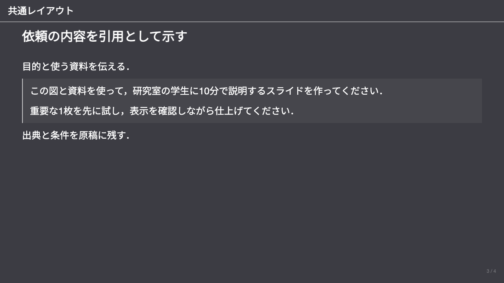
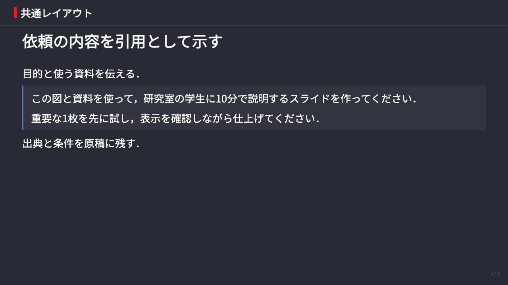

# Default composition comparison

基点は`2a4f937bbe6f4565a21ba8c7867e2e30948b3e50`で，比較対象のrevisionはmanifestのcandidateへ記録する．本文・図・条件を同一にしたCSS比較であり，紹介用作例の文章改稿との比較ではない．

## Conditions and inputs

- macOS arm64，Node 25.6.0，Chromium 145.0.7632.6，DPR 1．通常は1280×720，Labの4:3対照は1280×960．
- Google Fontsへのrequestを遮断し，Noto Sans JPをローカルの`@font-face`として読み込んだ．本文の実使用はCDPでcustom fontとして確認した．SVG素材内の文字は同じ画像データを使っており，その内部fontを本文のprobeで検証したとは扱わない．
- 元のvariable TTFは[Google FontsのNoto Sans JP](https://github.com/google/fonts/tree/main/ofl/notosansjp)から取得し，CIと同じSHA-256 `c2f3b4d463500a2ddcd3849cded1fceeb9fd6d1c32e6cbecd568453ba50fc68f`を確認した．fonttools 4.60.1でweight 400へinstancingしたTTFのSHA-256は`1d006e8fd34c46e74a807f047225451db56485aa0da083c3bac572d88cee00d9`である．
- [controls.md](controls.md)は短文・読み幅・引用・自然寸法の図を比較する固定原稿である．図は配置確認用の自作fixtureであり，実測データではない．
- 代表レイアウト14例は，基点の[`fixtures/layout-baselines/slide.md`](https://github.com/takumi-nishimura/MarpAgent/blob/2a4f937bbe6f4565a21ba8c7867e2e30948b3e50/fixtures/layout-baselines/slide.md)を両条件へ固定した．このPRで現行の表2例へ加えたbody wrapperは，CSSだけの比較入力へ混ぜていない．元のSVGを同じdata URIへ変換して両条件へ与えた．
- [manifest.json](manifest.json)に原稿・CSSのhash，本文fontの観測値，対照の寸法と各ケースのaudit要約を保存した．3テーマの14例と4対照，Labの4:3の4対照を，変更前後で計116枚描画した．保存済みの歴史的な`baseline/`は変更していない．

## Observations

| Case / region | Observed change | Verification |
| --- | --- | --- |
| short-explanation / header and body | Labの文脈ヘッダーを小さくし，本文と同じ左右余白へ揃えた．見出しから本文先頭までは9.75px→35.75pxとなり，短い本文が見出しへ詰まらない．余った高さは本文の後ろへ残る | DOM寸法と画像を確認．本文量1段落／5段落，16:9／4:3でも間隔を回帰検査 |
| reading-width / body | 明示した読み幅はLabで1200px→720px．上端配置と読み幅を併用できる．通常のbody boxは広い領域を使える | DOM寸法と画像を確認．短文という理由だけで中央配置を既定にはしない |
| quotation / quoted text | 3テーマで左罫線・薄い背景・内側余白が付く．本文と同じ文字サイズを保ち，引用の最初と最後のmarginを重ねない | 3テーマの描画テストと画像を確認 |
| quotation and context header / color palettes | 引用背景は現在の前景・背景色を混ぜ，Labの小さな文脈ラベルは前景色を使う．固定の明るい引用背景や低contrastの文脈色を暗色へ持ち込まない | 3テーマ×8配色の引用と，Labの8配色のヘッダーを計測．暗色の原寸画像も確認 |
| natural-caption / image and caption | 画像とcaptionを自然寸法のグループとして中央に置く既存の選択肢を保持する．Labの画像とcaptionの間隔は変更前後とも9.75px | DOM寸法と画像を確認．fitting図一般の間隔改善を示す例ではない |
| columns-portrait / lower edge | 既存の縦長図の境界例は未解消．3テーマともclippingが2件残り，Labの最大はみ出しは83px→85px，mujiは85px，toshibaは98pxだった | 固定原稿とauditを比較し，Labの原寸画像でも確認．この例を標準例の品質達成として扱わない |

Labの長い見出し，長いcaption，縦長図，縦積み，長い脚注，追加行の表も原寸で目視した．固定した14例でclippingが観測されたのは上記の縦長図ケースであり，それ以外に新しいtext overlap・極小文字の観測はなかった．これはmedia同士の衝突や科学的妥当性を保証する結果ではない．

## Images

各画像は左が変更前，右が変更後であり，4つの対照の全キャンバスを並べる．原寸の個別PNGとraw logは作業証跡へ保存した．

目視所見は配置についての作業者の判断であり，美観・投影時の可読性・理解度の普遍的な実証ではない．既存資料の一括移行は行わず，各資料の再描画で改行と図の収まりを確認する．

## Palette checks

引用の24条件では本文サイズが24px以上であることとcontrast比3:1以上，Labの文脈ヘッダー8条件では24px未満の文字で4.5:1以上を検査した．閾値の根拠は[W3CのContrast Minimum解説](https://www.w3.org/WAI/WCAG22/Understanding/contrast-minimum.html)である．これは対象要素と選んだ配色の回帰検査であり，資料全体のWCAG適合監査ではない．

最初の引用背景では暗色を含む3テーマの試験が失敗し，Labの小さな文脈ラベルもDracula配色で約3.03:1となった．背景・文字色の追従を修正した後にすべて成功した．初回の失敗画像とlogも作業証跡へ保持した．

