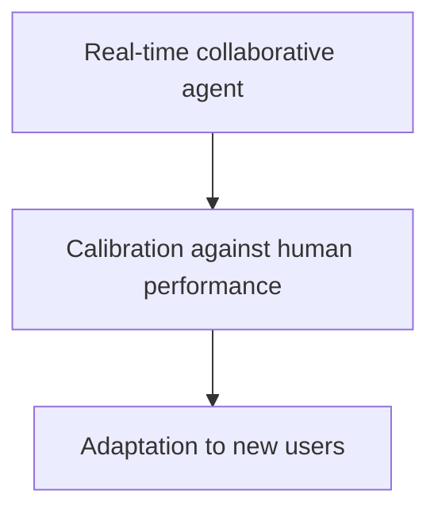
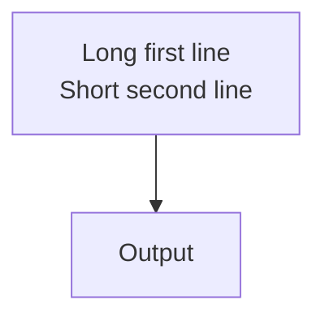

# Usage reference

Detailed commands, rendering conditions, distribution behavior, and authoring features.
Start with the [README](../README.md) for setup and the first deck, or open the
[introduction example](../decks/example/slide.pdf).

- [Rendering environment](#rendering-environment)
- [Commands](#commands)
- [File structure and media ownership](#file-structure)
- [Themes and diagrams](#theme)
- [A-series paper layouts](#a-series-paper-layouts)

## Rendering environment

Marp CLI is pinned to 4.5.1 and Marp Core to 5.0.2. The repository config
explicitly constructs the Core 5 `@marp-team/marp-core/full` engine, so exports
and in-process slide parsing use the same features even when launched outside
this directory. CLI also installs its own Core 4 fallback dependency; that copy
is not the configured renderer.
All optional Core 5 rendering dependencies are declared in `package.json`.

Code highlighting uses Shiki. Shared themes map `--marp-shiki-*` variables to
their existing light/dark design tokens; custom `.hljs-*` overrides need to be
migrated to these variables. Plain Mermaid fences retain the repository's
cached renderer with diagram math, while attributes such as `mermaid interactive`
use the upstream renderer. See the [Core 5 migration guide](https://github.com/marp-team/marp-core/blob/v5.0.2/docs/migration-v5.md)
and [ADR-0004](decisions/ADR-0004-adopt-marp-core-5-with-explicit-full-engine.md).

For runnable examples of code line highlighting (`js {2,4-5}`), diagram math,
and native Mermaid, see [template/core5-components.md](../template/core5-components.md).

`d2` fences render self-contained static diagrams through the same engine.
Install the pinned host D2 0.9.0 explicitly; the application never installs it
at runtime. TALA is the project default, and source `vars.d2-config` can select
ELK or Dagre. Japanese labels require an explicitly supplied suitable TTF font.
See [D2 setup, scope, diagnostics and acceptance tests](d2.md).

## Legacy outlines

New decks do not need `outline.md`. Existing outlines are left intact, and any
unique requirements in them should be considered when editing a legacy deck.
An outline can still be supplied when explicitly requested, but is not a second
document to maintain by default. For compatibility, `marpx <brief.md> --outline`
(including `--output`, `--force`, and `--no-strict-brief`) still works with the
former eight-section brief format and prints a deprecation warning to stderr.
The shorter new brief is not an input contract for that legacy generator.

## Commands

The reference uses `marpx` for brevity. With mise shell activation enabled,
`.mise.toml` adds the repository root to `PATH`. Use `./marpx` when mise is
installed without shell activation, or `npm run marpx --` with another Node.js
25.x manager. Avoid `npx marpx` in this checkout: the package's own bin is not
linked into `node_modules/.bin`.

| Command | Description |
| :------ | :---------- |
| `marpx -n decks/<path>` | Scaffold a new deck |
| `marpx -n decks/<path> --paper` | Scaffold a new A-series paper deck |
| `marpx <slide.md>` | Serve with live reload |
| `marpx <slide.md> <page>` | Serve and open at displayed page |
| `marpx <slide.md> --screenshot <page>` | Save a screenshot to the system temporary directory and print its path |
| `marpx <slide.md> --screenshot <page> --output <path>` | Screenshot the slide at a displayed page to a chosen path |
| `marpx <slide.md> -p` | Single-shot preview |
| `marpx <slide.md> [page] --overview` | Thumbnail overview (optionally focused on a displayed page) |
| `marpx <slide.md> --pdf` | Export to PDF |
| `marpx <slide.md> --pptx` | Export to PPTX |
| `marpx <slide.md> --html` | Export to standalone HTML |
| `marpx <slide.md> --zip --output out/talk.zip` | Export portable HTML and referenced local resources |
| `marpx <slide.md> --zip --dry-run` | Inspect the manifest without writing an archive |
| `marpx <slide.md> --zip --strict-offline` | Reject remote and unsupported resource dependencies |
| `marpx <slide.md> --images [png\|jpeg]` | Export each slide as an image (default: png) |
| `marpx <slide.md> --pdf --output <path>` | Export to a chosen path (also `--pptx`, `--html`, `--images`) |
| `marpx <slide.md> -v` | Validate (`--lint` is a deprecated alias) |
| `marpx <slide.md> -v --autofix` | Apply safe autofixes, then validate |
| `marpx <slide.md> -v --autofix --dry-run` | Show the autofix diff without writing |
| `marpx <slide.md> -v --strict` | Validate and fail if the rendered check cannot run |
| `marpx <slide.md> -v --hints` | Also list non-blocking source-heuristic hints |
| `marpx <slide.md> -v --format sarif` | Emit SARIF JSON for code-scanning pipelines |
| `marpx <slide.md> -v --report-dir out/<name>` | Validate with report |
| `marpx --doctor` | Run environment diagnostics |
| `marpx assets list --repo <path> --format json` | List media, metadata, aliases and source locations |
| `marpx assets search "caption" --repo <path> --preview` | Search filenames/source context and write a local preview |
| `marpx assets doctor --repo <path>` | Diagnose media and symlink conventions |
| `marpx assets reuse <source> <dest> --repo <path> --dry-run` | Plan a named relative file symlink without writing |
| `marpx --theme` | Build all themes |
| `marpx --theme lab` | Build a single theme |
| `marpx --theme-new <name> --source-url <url>` | Scaffold a new theme |
| `marpx --theme -w` | Watch-build themes |
| `npm test` | Run unit tests |
| `npm run test:ci` | Run browser-free engine smoke and CI regression tests |
| `npm run ci:full` | Run records + fixed D2 + portable D2 ZIP + strict quality gate after tool preparation |
| `npm run quality:gate` | Run unit tests + fixture/example validation + E2E tests |
| `npm run quality:gate:strict` | Run the quality gate with required visual checks and strict E2E policy |
| `npm run audit:dependencies` | Compare the production dependency audit with the reviewed ISS-0042 baseline |
| `npm run test:e2e` | Run Playwright browser and CLI E2E tests |

### Find and reuse media

Media discovery is read-only; `--preview` writes only temporary HTML. Private,
hidden-path and Git-ignored media are excluded by default, including symlink
targets. Use `--include-private` explicitly when those local results are needed.
Hidden slides are labeled separately from displayed pages.

Before changing or deleting a source asset, find its consumers with
`marpx assets list --repo <path> --uses decks/owner/assets/img/figure.svg`.
For reuse, inspect the `--dry-run` source/destination/relative target, then run
the same command without `--dry-run` to create the selected file symlink.
Existing paths are never overwritten; symlink failures never fall back to a
copy. See [media discovery and reuse](media-assets.md) for examples,
visibility rules, preview behavior, and Windows checkout diagnostics.

### Verification and contributors

Automatic PR/main CI always validates record integrity. It skips engine
installation for changes confined to `docs/` and `decks/`; other changes run
`test:ci`. Manual dispatch retains full acceptance. A green automatic check is
not full acceptance; see [CI scope and the pre-merge local fallback](ci.md).

The CI regression tests in `test:ci` and `npm test` also require Git, Bash, and
uv. Run `uv run .github/records.py validate` first to prepare the pinned Python
dependencies; record fixtures reuse that cache offline.

`npm test` requires a working Playwright Chromium installed as described above.
Individual visual tests can skip when launch prerequisites are missing, but an
explicit availability test fails so a browserless unit run cannot pass.
Non-strict E2E smoke tests skip only known missing browser prerequisites;
rendering errors and assertions fail.
Strict gates allow no browser-environment skips. CLI smoke commands time out
after 20 seconds and terminate their process group, including browser descendants.

Dependency auditing runs separately from `quality:gate`. Run
`npm run audit:dependencies` to compare production findings against the reviewed
baseline tracked in [ISS-0042](issues/ISS-0042-track-production-dependency-audit-findings.md).
A passing audit can include those known unresolved findings. CI runs this check
for changes to dependencies or audit tooling, and weekly to catch newly
published advisories.

### Exports and browser selection

All exports go through the repository Marp config (plugins, BudouX, theme
set). Browser-backed exports (`--pdf`, `--pptx`, `--images`, and the browser
opened by `-p`) use `CHROME_PATH` or an installed Chrome/Edge when one is
found, and fall back to Playwright's bundled Chromium otherwise — the
`chromium-headless-shell` build is preferred over "Chrome for Testing",
which can stall on some macOS machines. A conversion that does not finish
within `MARP_AGENT_CONVERT_TIMEOUT_MS` (default 120000 ms) is aborted with an
error; raise that variable for very large decks. Without `--output`,
files land next to the slide deck:
`slide.pdf`, `slide.pptx`, `slide.html`, or `slide.001.png`-style image
sequences. For `--images`, `--output` is the file prefix —
`--output out/slide.png` produces `out/slide.001.png`, `out/slide.002.png`, …

The timeout also bounds validation rendering, report image exports, and
`--screenshot`, including browser operations. Set a positive integer in
milliseconds; zero, negative, and invalid values are rejected. A timeout
terminates the conversion and its browser processes. Interactive preview
and watch sessions remain open until stopped. HTML export needs no browser.
Browser fallback candidates are checked before use; if none exists, the
diagnostic lists attempted paths and the browser installation command.

### Preview addresses and ports

Live serve and overview listen on `127.0.0.1` by default. To preview from
another device on a trusted LAN, use
`MARP_AGENT_BIND_ADDRESS=0.0.0.0 marpx <slide.md>` or append `--overview`.
The startup output lists URLs using the machine's actual network addresses.
An explicit local IP, `localhost`, or IPv6 address also works. Non-loopback
binding exposes the deck directory and linked shared assets to the network
without authentication; the repository enables `allowLocalFiles: true`.
Use this only for trusted preview sessions. Marp CLI 4.5.1 has no bind-address
option, so a child-scoped adapter supplies the host for its HTTP server and
watch notifier. `MARP_AGENT_NO_OPEN=1` disables automatic browser opening;
if an opener such as `xdg-open` is missing, the server keeps running and
prints a URL that can be opened manually.

Live serve starts on HTTP port 8080 when `PORT` is absent. If Marp reports
that the port is already in use, it retries successive ports through 8089
and exits with an error if all ten candidates fail. The startup URLs and
automatically opened browser URL use the selected port and retain a requested
displayed page. Setting `PORT` explicitly (for example,
`PORT=8090 marpx <slide.md>`) disables this fallback, so an occupied explicit
port produces Marp's original error. Overview keeps its existing port selection.

### Environment diagnostics

`marpx --doctor` reports the CLI and configured Core versions and renders
small Shiki, line-highlight, KaTeX, MathJax, diagram-math, and native-Mermaid
probes through the same engine used for exports. A missing rendering feature
fails the diagnostic; the browser availability check is reported separately.

### Distribute HTML

HTML export keeps relative references to deck media instead of embedding
them. Open the HTML from the deck directory (the default output location)
so `assets/` and `shared/` paths resolve; an `--output` path outside the
deck breaks those references. PDF, PPTX, and image exports embed media and
are not affected.

For distribution, use `marpx <slide.md> --zip --output out/talk.zip`.
The archive contains `index.html`, ordinary resource files, `manifest.json`,
and a short `README.txt`. It materializes shared and cross-deck symlinks
without copying whole asset directories. Collection starts from the rendered
visible slides and follows local CSS imports, CSS URLs, and SVG resources.
CSS rules are collected conservatively, including selectors that are unused.
Speaker notes and production comments are excluded; visible citations remain.
Source Markdown, briefs, dotfiles, editing files, and unrelated assets are
excluded. The manifest records rewritten content hashes, repository-relative
sources, reference relationships, and 1-based rendered slide positions.

Run `--zip --dry-run` to inspect planned files, resource sizes, remote
dependencies, exclusions, and errors as JSON without creating an archive.
The command exits unsuccessfully when collection errors occur, including
in dry-run mode. `--strict-offline` additionally rejects remote dependencies
and unsupported custom JavaScript or embedded documents. Remote resources
are listed in the manifest and archive README and are never downloaded.
Static analysis supports the installed Marp runtime and presenter helpers;
it does not execute custom scripts to discover their dependencies.

Resources must remain within this repository after symlink resolution.
For a deck in another repository, explicitly set `--bundle-root <repo>`.
Absolute paths, `file:` URLs, missing files, symlink escapes, and dependency
cycles fail collection. The shared bundle resolver also rejects absolute
symlink targets, direct cross-deck paths, and directory-level reuse. Reuse
other decks' resources through named relative file symlinks; the standard
deck-local `shared -> repo/assets` directory link is supported. CSS/SVG URLs
resolve relative to the resource URL while policy checks retain the original
consuming deck's scope. Resolver diagnostics are reduced to stable error
codes and repository-relative origins in the distribution manifest.
Only explicitly referenced repository font files
are collected; publishers must have permission to redistribute those fonts.
OS fonts are never collected. The default resource limits are 10,000 files
and 256 MiB, configurable with `--max-bundle-files` and `--max-bundle-bytes`.
ZIP compression is performed in memory within those limits.

An existing ZIP requires `--force`. Preparation finishes before atomic
publication, so conversion, collection, and archive failures preserve
existing output and source files. Repeated exports of the same rendered
HTML use stable entry order, paths, timestamps, modes, and content hashes;
different renderer versions may produce different HTML.

After extraction, open `index.html`. Relocated, network-blocked Chromium
tests cover local images, nested CSS, SVG, video, audio, math, Mermaid, and
navigation across all visible slides using both `file:` and local HTTP.
Browser security rules and media codecs can limit direct `file:` viewing,
fonts, and presenter synchronization. For consistent viewing, serve the
extracted directory as a static HTTP root; with Python 3 installed, run
`python3 -m http.server 8000 --bind 127.0.0.1` from that directory and open
`http://127.0.0.1:8000/index.html`.

D2 ZIP acceptance is available separately as `npm run test:zip:d2` with
`MARP_AGENT_D2_PATH` set to D2 0.9.0 and `MARP_AGENT_D2_FONT_PATH` set to an
explicit Japanese TTF. The test deletes the source repository, compiler
alias, and font input before opening the extracted ZIP through both `file:`
and HTTP with remote networking blocked and an empty browser process PATH.
It verifies embedded fonts, Japanese diagram labels, repeated diagram IDs,
math, and all displayed pages. Actual D2 compile and missing-tool failures
must preserve the existing ZIP. The recipient needs a browser to view the
static bundle; D2 is used during export.

### Slide identities and validation output

Slide numbers come from one slide map computed with the configured Marp
engine (`src/slide-map.js`), so hidden slides, empty slides, setext headings,
and `headingDivider` count the way Marp renders them. Page arguments for
serve, `--overview`, and `--screenshot` take the page number shown on the
slide; decks that show no page numbers take the position among rendered
slides, and hidden slides cannot be addressed. The validator reports the
Markdown slide index and adds the displayed page when it differs, for example
`slide 11 (page 10)`; JSON and SARIF findings also carry `renderedSlide`,
`sectionId`, `page`, and the slide's first source `line`.

Validation exits with 1 for blocking findings and 2 for execution or report
output failures. A failed screenshot or report write preserves the measured
findings; JSON lists output failures in `artifacts.errors`, while `report.json`
and SARIF run properties use `artifactErrors`. Report screenshots use the same
browser selection and conversion timeout as image exports.

Rendered Mermaid source fallbacks are blocking `diagram-render-error`
findings. Visible KaTeX and MathJax errors, including errors inside diagrams,
are `math-render-error` findings. They carry the same slide identity as other
rendered findings; hidden slides and literal code examples are ignored. A
successful native fallback does not count as a diagram error. These checks
require the rendered validation pass. See [ADR-0005](decisions/ADR-0005-report-rendered-diagram-and-math-failures.md).

Autofix changes tiny typography classes in HTML `class` attributes and removes
plain `<small>` wrappers. It preserves image URLs, prose, code examples, and
the original line endings. Use `--autofix --dry-run` to inspect the edits.

### Scroll a selected slide during presentation

Add `<!-- _scroll: true -->` to an intentionally long slide, such as a detailed
table or appendix. It applies only to that page:

```markdown
<!-- _scroll: true -->
## Detailed results

Long table or body content goes here.

---

## Next slide

This page uses the normal layout and navigation.
```

In `marpx` live presentation and exported Bespoke HTML, the body scrolls with
the wheel, trackpad, touch, or Up/Down/PageUp/PageDown/Home/End. Header, first
top-level heading, footer, and page number stay fixed. Left/Right and existing
page controls still change slides. Focused form controls keep their own keys.
The shared `lab`, `muji`, and `toshiba` themes include this layout.

Open the presenter window from the same presentation (`p` or the presenter
button). The current page's scroll position synchronizes in either direction,
including a presenter opened after scrolling. Each page remembers its position
when revisited. Synchronization is within the same browser/origin and native
Marp presentation session; independently opened presentations remain separate.

PDF, PPTX, images, and printing show only the initial body viewport. Validation
reports a non-blocking `scroll-export-overflow` warning when detail would be
omitted, while checking successive scroll positions for clipping, small text,
collisions, and rendering errors. Split the page for a complete static handout.
See the [runnable example](../fixtures/scroll-slide.md) and
[ADR-0006](decisions/ADR-0006-adopt-opt-in-synchronized-slide-body-scrolling.md).

For interactive authoring, use `marpx ...`. `.mise.toml` adds the repository
root to `PATH` when mise is active, and the repo-local wrapper runs the npm
script through `mise exec`, so it keeps the Node.js 25 runtime pinned by this
project while still letting the shell complete paths such as
`decks/example/slide.md`. If the current shell has not loaded mise yet, use
`./marpx ...` from the repository root.

## File Structure

```
MarpAgent/
├── decks/              # Your slide decks
│   └── <name>/
│       ├── brief.md
│       ├── slide.md
│       ├── assets/
│       └── shared -> ../../assets
├── assets/             # Shared assets (logos, fonts)
├── themes/             # Marp entries and surfaces built with Tailwind CSS v4
├── src/                # Rendering, previews, validation, and CLI support
├── scripts/            # CLI tools, rendering plugins, and quality checks
├── fixtures/           # Rendered validation examples and regression cases
├── tests/              # Unit and browser/CLI E2E tests
├── docs/               # Engineering contracts and issue/decision records
└── .agents/skills/     # AI agent authoring skills
```

### Media ownership and reuse

Keep presentation-specific images and videos under the deck that owns them. When another deck reuses a file, add a named relative symlink for that file in the corresponding local media directory instead of copying it, linking the owner's complete `assets/` directory, or using a raw `../other-deck/` path. For example, from the repository root:

```bash
mkdir -p decks/consumer-deck/assets/img
ln -s ../../../source-deck/assets/img/example.png \
  decks/consumer-deck/assets/img/from-source-example.png
```

The consuming deck can then use a stable path such as `assets/img/from-source-example.png`. Add another symlink only when it reuses another file. Before renaming or deleting owned media, search the repository for symlinks and Markdown references that consume it.

Use the repository-level `assets/` directory only for stable resources with no single owning deck, such as shared logos and fonts. On Windows, enable symlink support before checkout and verify that Git did not materialize a link as an ordinary file or copied directory.

## Theme

MarpAgent themes are built on Tailwind CSS v4 from design-level `DESIGN.md`
token sources. Available themes:

- `lab` — default research presentation design
- `muji` — quiet, minimal MUJI-inspired design
- `toshiba` — high-contrast Toshiba-inspired technical presentation design

Common capabilities:

- Five color schemes: Dracula, One Dark Pro, Nord, Neogaia, GitHub Light
- Slide composition: shared Tailwind grid/flex utilities, unequal columns,
  comparison tables, evidence with context, and process rows
- Optional components: visual col, metric grid, timeline, placement utilities
- Callouts: `.note`, `.tip`, `.important`, `.warning`, `.caution`
- Typography scale: `.text-xs` through `.text-xl5`
- Laser pointer effect during presentation
- Mermaid diagram support with MathJax

See [designs/README.md](../designs/README.md) for the design index,
`designs/<name>/DESIGN.md` for each visual identity, and the
[theme contract](theme-contract.md) for the engineering contract
shared by CSS, templates, skills, Tailwind, and the validator.

Shared themes load Noto Sans JP from Google Fonts. Offline rendering can use
fallback fonts with different text widths. For repeatable exports, install the
same font version or supply deck-local fonts, and keep the browser version fixed
as described in the theme contract.

`designs/<name>/DESIGN.md` is the source of truth for each design's tokens.
`marpx --theme` regenerates the matching
`themes/src/_generated/<name>-design-tokens.css` files before compiling the
tracked theme CSS files. Tailwind scans no deck or documentation files: decks
may use the theme's documented classes and their own deck-local styles, but not
arbitrary Tailwind utilities. `npm test` fails when a tracked theme differs from
a fresh build.

Start from the [composition recipes](../template/README.md) when choosing a layout.
Their [renderable source](../template/layouts.md) is checked by the fixture gate.
The shared utility set handles structure and spacing without choosing card
surfaces or changing the theme's colors and type. Use a table for shared
comparison criteria and unequal columns for evidence plus interpretation;
choose card components only when the content calls for them.

To create another visual identity, start from the scaffold command and then
edit the generated `DESIGN.md` as the token source of truth:

```bash
marpx --theme-new <name> --source-url <url> --no-build
```

The scaffold creates `designs/<name>/DESIGN.md`, `themes/src/<name>.css`, and
`fixtures/<name>-slide.md`. The `theme-new` agent skill describes the full
extract-adapt-validate workflow for URL, brand-guide, and existing DESIGN.md
sources.

Use `theme: lab`, `theme: muji`, or `theme: toshiba` for slide decks and
A-series paper layouts.
Canvas size is an explicit frontmatter concern: `16:9`, `4:3`, `a4-portrait`,
`a4-landscape`, or a custom pixel size such as `400x200`. Paper layout is
selected by the `.paper-header` / `.paper-columns` structure, not by a separate
theme or slide class.

A leading UTF-8 BOM is removed before Marp parses the deck, so rendering,
slide identities, and canvas inspection use the same frontmatter directives.
Source edits retain the original BOM and source offsets. Frontmatter closing
delimiters may contain extra dashes or trailing spaces, as in Marp itself.

### Adjacent alerts

Separate alerts with an empty line without a `>` marker:

```markdown
> [!NOTE]
> First alert.

> [!WARNING]
> Second alert.
```

A line containing only `>` starts another paragraph in the same alert. As on
GitHub, a later `[!WARNING]` in that blockquote remains ordinary body text.

### Mermaid sizing

Mermaid diagrams are rendered to SVG before the slide is styled. Changing
`svg text { font-size: ... }` with scoped CSS changes the visible text only;
it does not rerun Mermaid layout, so node boxes and edge routes keep their
original dimensions.

To make a Mermaid diagram larger, scale the rendered SVG/container instead:

````markdown
<div style="width: 90%; --mermaid-width: 115%; --mermaid-max-width: none; --mermaid-overflow: visible">



</div>
````

Use `--mermaid-width`, `--mermaid-max-width`, `--mermaid-max-height`, and
`--mermaid-overflow` on a wrapper when the default diagram size does not fit.
Do not rely on post-render text font-size changes for node sizing.

These sizing controls apply to both plain and attribute-bearing Mermaid
fences. Both use the active theme's Shiki palette. Override
`--marp-mermaid-foreground`, `--marp-mermaid-line`, or `--marp-mermaid-accent`
on the wrapper for a local color change; cached SVGs follow the CSS variables.

For node label line breaks, use `<br/>` or `\n` inside a quoted Mermaid label.
Explicit line breaks are measured before layout, so the node box height grows
with the line count and the width follows the longest visual line:

````markdown

````

### Title logo sizing

Themes default to no logo. Set `--logos-dark` and `--logos-light` to existing
deck-relative image URLs when your deck needs them.

Title slides default to height-based logo sizing so wide wordmarks remain
legible. Override `--logo-title-background-size` in deck frontmatter only when
you need a different title logo height:

```yaml
style: |
  section {
    --logos-dark: url(shared/logos/haptics_lab/logo_gray.svg);
    --logo-title-background-size: auto 50px;
  }
```

```bash
marpx --theme lab   # build theme
marpx --theme -w    # watch mode
```

## A-Series Paper Layouts

For dense one-page research outputs, `theme: lab` can render a single A-series
paper canvas instead of a slide sequence.

```bash
# Scaffold a paper deck (A4 portrait)
marpx -n decks/my-paper --paper

# Edit decks/my-paper/paper.md, then preview / validate / export
marpx decks/my-paper/paper.md        # live preview
marpx decks/my-paper/paper.md -v     # validate
marpx decks/my-paper/paper.md --pdf  # export PDF for printing
```

- **Portrait:** `size: a4-portrait` in the front matter
- **Landscape:** `size: a4-landscape`
- **Columns:** controlled by the number of `<div class="paper-col">` blocks
  (three for portrait, four for landscape)
- **Cards:** `<section class="paper-section">` with an `## h2` title bar; add
  `highlight` for a key-result card
- Callouts, figures, tables, code, and Mermaid all work inside cards

Export at A4 and scale at print time when a larger physical sheet is needed.
The validator skips the per-slide source hints for A-series paper outputs
(a dense full page is expected) but still flags content clipped at the page edge. See
`decks/example-paper/paper.md` for a worked example and the `marp-paper` skill
for authoring details.
