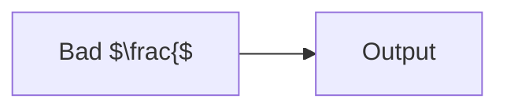

<!-- _paginate: skip -->

## Healthy content and literal examples

Valid math $x^2$.

```html
<span class='katex-error'>This is a code example.</span>
```

---

<!-- _hide: true -->

## Hidden broken content

$\frac{$

```mermaid
not a diagram
```

---

## Broken body math

$\frac{$

---

## Broken cached diagram

```mermaid
not a diagram
```

---

## Broken native diagram

```mermaid interactive
not a diagram
```

---

## Broken diagram math

<div style="--mermaid-width: 60%; --mermaid-max-height: 180px">



</div>
