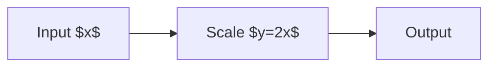
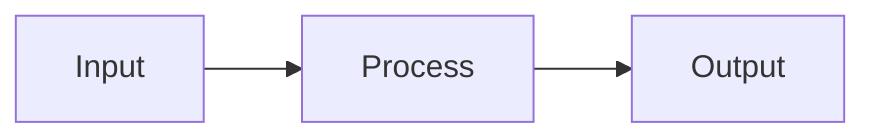

## 説明するコードの行を強調する

空配列への対応と，平均を返す処理を強調する．

```js {2,4-5}
function average(values) {
  if (values.length === 0) return 0;
  const total = values.reduce((sum, value) => sum + value, 0);
  const count = values.length;
  return total / count;
}
```

行番号はコードの先頭から数える．配色と強調行の背景はテーマに従う．

---

## 図中の数式を含む研究図を描く

通常のMermaidでは，図中の数式と描画キャッシュを利用できる．

<div style="--mermaid-width: 75%; --mermaid-max-height: 250px">



</div>

本文の数式 $y=2x$ と，図中の数式を同じ原稿に記述できる．

---

<!-- _class: invert -->

## Core 5のMermaidも同じサイズ指定で使う

属性付きの図はCore 5の描画を利用する．

<div style="--mermaid-width: 75%; --mermaid-max-height: 250px">



</div>

HTMLでの操作に加え，PDFや画像での表示も確認する．
